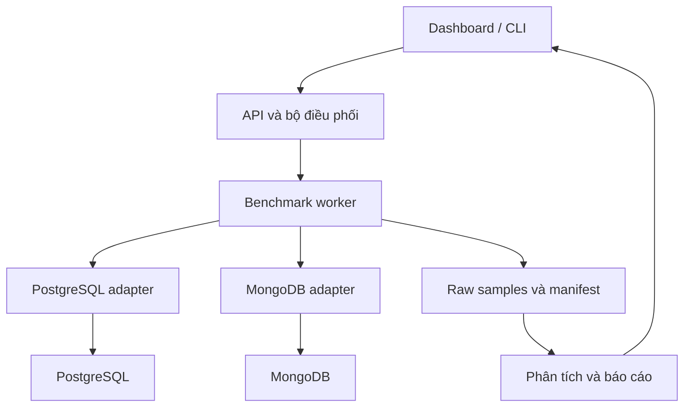

# ĐẶC TẢ TRIỂN KHAI THEO PHASE — POSTGRESQL VÀ MONGODB

## Đề tài: Đánh giá hiệu năng truy vấn giữa CSDL quan hệ (PostgreSQL) và CSDL NoSQL (MongoDB)

**Phiên bản:** 1.0  
**Ngày biên soạn:** 29/09/2026  
**Ngôn ngữ giao diện, báo cáo:** Tiếng Việt  
**Đối tượng sử dụng:** Sinh viên thực hiện đề tài và AI coding agent trong Google Antigravity  
**Loại tài liệu:** Đặc tả yêu cầu, thiết kế thí nghiệm, quy trình triển khai demo, kế hoạch kiểm thử và nghiệm thu.

> “Plase” trong yêu cầu được hiểu là **phase — giai đoạn triển khai**. Tài liệu đồng thời mô tả từng trang của ứng dụng demo. Đây là bản đặc tả để triển khai, chưa phải phần mềm đã xây dựng hoặc báo cáo benchmark đã chạy. Mọi giá trị cấu hình dưới đây là thiết kế đề xuất; không phải số đo thực nghiệm.

---

## 1. Mục tiêu và phạm vi

### 1.1. Mục tiêu nghiên cứu

Xây dựng một ứng dụng thực nghiệm cho phép chạy cùng yêu cầu nghiệp vụ trên PostgreSQL và MongoDB, kiểm tra tính tương đương của kết quả, đo hiệu năng, trực quan hóa và giải thích nguyên nhân khác biệt.

Các câu hỏi nghiên cứu:

1. Với dữ liệu và ngân sách tài nguyên đã kiểm soát, mỗi hệ có độ trễ và thông lượng như thế nào đối với từng nhóm truy vấn?
2. Tăng quy mô dữ liệu và số client đồng thời ảnh hưởng thế nào đến p50, p95, p99, throughput và tỷ lệ lỗi?
3. Bổ sung index làm thay đổi hiệu năng, dung lượng và thời gian xây dựng index ra sao?
4. JOIN trong PostgreSQL và `$lookup` trong MongoDB khác nhau như thế nào ở mô hình tham chiếu tương đương?
5. Nếu MongoDB nhúng các dòng chi tiết đơn hàng, kết quả đọc thay đổi ra sao và phải đánh đổi những gì về mô hình dữ liệu?
6. Execution plan có giải thích được kết quả quan sát hay không?

### 1.2. Kết quả phải bàn giao sau khi triển khai

- Mã nguồn chạy được bằng Docker Compose và hướng dẫn local.
- Dữ liệu giả lập tái tạo được bằng seed; schema, validator, indexes và query catalog.
- Dashboard có màn hình cấu hình, thực thi truy vấn, benchmark, phân tích và kiểm thử.
- CLI benchmark chạy độc lập với giao diện.
- Bộ kiểm thử tự động và báo cáo PASS/FAIL/SKIPPED.
- Dữ liệu đo thô, manifest môi trường, execution plans, biểu đồ và báo cáo Markdown.
- Kịch bản demo trên lớp 10–12 phút; chế độ mở kết quả đã đo khi không đủ thời gian chạy trực tiếp.

### 1.3. Phạm vi bắt buộc và mở rộng

| Mức | Nội dung |
|---|---|
| Bắt buộc | Truy vấn đọc, lọc, sắp xếp, phân trang, tổng hợp, JOIN/lookup; 3 quy mô; 2 chế độ index; kiểm tra kết quả; benchmark concurrency |
| Bắt buộc | Một máy, mỗi CSDL một instance; không sharding/replica benchmark; cùng snapshot dữ liệu trong từng cặp so sánh |
| Bắt buộc | Track A: PostgreSQL chuẩn hóa so với MongoDB tham chiếu; Track B: đọc chi tiết đơn hàng bằng PostgreSQL chuẩn hóa so với MongoDB embedded |
| Mở rộng | CRUD đơn bản ghi, workload 95% đọc–5% ghi, tập dữ liệu lớn hơn RAM, open-loop load |
| Ngoài phạm vi cốt lõi | Tính sẵn sàng cao, failover, giao dịch phân tán, chi phí cloud, full-text search, vector search, đo điện năng |

Không kết luận “SQL luôn nhanh hơn NoSQL” hoặc ngược lại. Chỉ kết luận theo workload, dữ liệu, cấu hình, phiên bản và phạm vi đã đo.

## 2. Quy tắc làm việc với Antigravity

### 2.1. Cách dùng tài liệu

1. Đặt tài liệu vào repository tại `docs/SPEC.md`.
2. Mở repository trong Antigravity, yêu cầu agent đọc toàn bộ tài liệu.
3. Dùng Planning Mode hoặc yêu cầu tạo Implementation Plan trước khi triển khai phần lớn. Antigravity có artifact kế hoạch để kiểm tra và phản hồi [R1].
4. Triển khai theo Phase 0 → 10. Chỉ đánh dấu một phase hoàn tất khi đạt gate nghiệm thu tương ứng.
5. Sau mỗi phase, cập nhật checklist, bằng chứng kiểm thử và phần việc còn lại. Tuân theo chính sách review của workspace; không tự coi file kế hoạch là bằng chứng đã chạy.

Các tên file dưới đây là **quy ước của dự án**, không phải tên file bắt buộc hoặc cơ chế tự nạp mặc định của Antigravity:

| File | Nội dung |
|---|---|
| `docs/SPEC.md` | Đặc tả này |
| `docs/implementation-plan.md` | Phân rã công việc, phụ thuộc, quyết định thiết kế |
| `docs/tasks.md` | Checklist từng phase, trạng thái, đường dẫn bằng chứng |
| `docs/decisions.md` | Nhật ký thay đổi schema, index, cấu hình, phương pháp đo |
| `docs/test-report.md` | Kiểm thử đã thực hiện, kết quả và lỗi còn lại |
| `docs/walkthrough.md` | Cách khởi động, ảnh demo, lệnh đã kiểm chứng |
| `docs/limitations.md` | Hạn chế phương pháp và môi trường |

### 2.2. Quy tắc triển khai cho agent

- Không tạo số đo giả, không viết “đã kiểm thử” khi chưa có log hoặc kết quả thực tế.
- Không hardcode bên thắng, thời gian đáp ứng hoặc biểu đồ mẫu vào trang kết quả thật.
- Có thể dùng fixture UI nhưng phải gắn nhãn **DỮ LIỆU MINH HỌA**, lưu riêng và không cho xuất thành báo cáo thực nghiệm.
- Khi thiếu thông tin, dùng mặc định trong tài liệu, ghi giả định; không đổi phương pháp giữa các lần chạy mà không tăng phiên bản cấu hình.
- Dùng truy vấn tham số hóa; không nhận SQL hoặc JavaScript tùy ý từ giao diện.
- Không xóa database/volume ngoài namespace của dự án. Reset phải nêu rõ dataset, namespace bị tác động và cần thao tác xác nhận tại giao diện/CLI.
- Không dừng ở scaffold, nút giả, API trả cố định hoặc test chỉ kiểm tra implementation tự khớp chính nó.
- Không chạy tác vụ sinh dữ liệu, tạo index hoặc benchmark song song làm nhiễu nhau.
- Không âm thầm giảm dữ liệu, concurrency, số lượt hoặc duration để có kết quả đẹp.

## 3. Kiến trúc và công nghệ

### 3.1. Stack đề xuất

| Thành phần | Lựa chọn |
|---|---|
| Giao diện | React + TypeScript + Vite; thư viện biểu đồ thống nhất |
| API | Python + FastAPI + Pydantic |
| PostgreSQL client | Psycopg 3 và connection pool |
| MongoDB client | PyMongo, một client dùng lại trong mỗi process |
| Runner | Python CLI dùng chung adapter với backend; process worker riêng |
| Kiểm thử | pytest cho core/API/integration; Playwright cho luồng giao diện |
| Thống kê, biểu đồ xuất báo cáo | NumPy/Pandas và Matplotlib |
| Lưu kết quả | JSONL/CSV/JSON trên filesystem, tách khỏi hai CSDL được đo |
| Job metadata | SQLite nhỏ hoặc file trạng thái atomic; không dùng DB đang benchmark làm kho kết quả |
| Hạ tầng | Docker Compose; Linux hoặc Windows qua Docker Desktop/WSL2 |

Chốt phiên bản patch và image digest ở Phase 0; không dùng `latest` trong bản nộp. Có thể chọn nhánh PostgreSQL 17 và MongoDB 8.0 để bắt đầu kiểm tra tương thích, nhưng đây là lựa chọn thí nghiệm, không phải tuyên bố phiên bản mới nhất. Nếu chọn nhánh khác phải cập nhật tài liệu, lockfile và manifest.

### 3.2. Luồng dữ liệu



Benchmark chính gọi trực tiếp adapter trong runner. Không lấy thời gian click trình duyệt hoặc HTTP round-trip làm “thời gian truy vấn CSDL”. Benchmark API, nếu làm, phải có nhãn và báo cáo riêng.

### 3.3. Phân lớp mã nguồn

| Đường dẫn dự kiến | Trách nhiệm |
|---|---|
| `backend/app/api/` | Endpoint, validation, trạng thái job |
| `backend/app/domain/` | Schema nghiệp vụ, query registry, kết quả chuẩn hóa |
| `backend/app/adapters/` | PostgreSQL, Mongo reference, Mongo embedded |
| `backend/app/benchmark/` | Scheduler, timer, worker, metrics, cancel |
| `backend/app/datasets/` | Generator, importer, manifest và integrity |
| `backend/app/reports/` | Tổng hợp, CI, biểu đồ, xuất Markdown |
| `frontend/src/pages/` | Các trang ở mục 10 |
| `queries/postgresql/` | SQL có phiên bản |
| `queries/mongodb/` | Bộ tạo filter/pipeline bằng Python |
| `configs/` | Profiles, query parameter pools, index catalog |
| `tests/` | Unit, integration, correctness, E2E |
| `scripts/` | Bootstrap, doctor, smoke, benchmark, export |
| `results/<experiment_id>/` | Kết quả bất biến sau khi hoàn tất |
| `docs/` | Đặc tả, quyết định, demo, báo cáo |

## 4. Dữ liệu và mô hình so sánh

### 4.1. Bối cảnh nghiệp vụ

Chọn hệ thống bán hàng: khách hàng, sản phẩm, đơn hàng và chi tiết đơn hàng. Không cần xây dựng checkout, thanh toán thật hoặc quản trị người dùng; ứng dụng phục vụ nghiên cứu truy vấn.

### 4.2. Dữ liệu gốc duy nhất

Generator tạo **một nguồn dữ liệu chuẩn** rồi chuyển đổi sang cả hai hệ. Không gọi hai bộ sinh random độc lập, dù cùng seed, vì thứ tự gọi khác nhau có thể làm dữ liệu khác nhau.

| Thực thể | Trường chuẩn |
|---|---|
| Customer | `customer_id`, `name`, `city_code`, `created_at` |
| Product | `product_id`, `name`, `category_code`, `base_price_minor` |
| Order | `order_id`, `customer_id`, `order_date`, `status`, `total_minor` |
| OrderItem | `order_id`, `line_no`, `product_id`, `quantity`, `unit_price_minor` |

Quy ước:

- ID là số nguyên 64-bit dương; MongoDB dùng BSON Int64 nhất quán. ID trong JSON gửi trình duyệt nên serialize thành chuỗi để tránh mất độ chính xác.
- Tiền là số nguyên theo đơn vị nhỏ nhất được chọn. Với VND, quy ước một đơn vị là 1 đồng; tên `_minor` chỉ quy ước lưu trữ, không giả định có xu.
- `total_minor = SUM(quantity × unit_price_minor)` của các dòng chi tiết. Giới hạn generator để mọi tổng nằm trong miền int64.
- `unit_price_minor` là giá tại thời điểm đặt hàng, không lấy lại từ giá sản phẩm hiện tại.
- Thời gian UTC, độ chính xác millisecond, khoảng sinh cố định `[2023-01-01T00:00:00Z, 2026-01-01T00:00:00Z)`. Không dùng thời gian hiện tại làm dữ liệu đầu vào.
- Các trường cốt lõi đều bắt buộc, không null. Missing/null chỉ xuất hiện trong fixture kiểm thử âm và không được nạp vào benchmark chuẩn.
- Mã trạng thái: `pending`, `paid`, `shipped`, `cancelled`. Mã thành phố/danh mục là ASCII; so sánh mã dùng quy tắc nhị phân tương đương, tránh đưa collation tiếng Việt vào phép đo cốt lõi.
- `line_no` bắt đầu từ 1, duy nhất trong đơn hàng, dùng để sắp xếp items.

### 4.3. Quy mô và phân phối

| Profile | Customers | Products | Orders | Items/đơn | Mục đích |
|---|---:|---:|---:|---|---|
| `fixture` | 12 | 20 | 50 | 1–5 | Kết quả oracle có thể kiểm tra bằng tay |
| `small` | 1.000 | 500 | 10.000 | 1–5 | Smoke, demo live |
| `medium` | 10.000 | 5.000 | 100.000 | 1–5 | So sánh chính trên máy cá nhân |
| `large` | 100.000 | 20.000 | 1.000.000 | 1–5 | Kiểm tra xu hướng tăng dữ liệu |

Tổng items lấy từ manifest, không mặc định đúng `3 × orders`. Số lượng này là kỳ vọng gần đúng nếu lấy đều 1–5.

Mặc định `seed=42`. Phân phối phải ghi rõ:

- Số items chọn đều 1–5; quantity chọn đều 1–10.
- 10 thành phố và 20 danh mục; mỗi mã có dữ liệu.
- Ngày đặt hàng chọn đều trong khoảng cố định; fixture riêng kiểm tra chính xác biên ngày.
- Trạng thái theo tỷ lệ mục tiêu 10% pending, 45% paid, 35% shipped, 10% cancelled; lưu tỷ lệ thực tế sau sinh.
- Dataset `uniform`: chọn khách hàng và sản phẩm gần đều.
- Dataset `skewed` mở rộng: 20% khách hàng nhận khoảng 80% lượt chọn đơn; phân phối này phải là dataset riêng, không trộn với uniform.
- Lưu min/max, histogram, cardinality, tổng tiền, số dòng và SHA-256 của nguồn chuẩn.
- Sinh theo batch, không giữ toàn bộ million-order dataset trong RAM.

### 4.4. Track A — Cấu trúc tham chiếu tương đương

PostgreSQL:

- `customers(customer_id PK, name, city_code, created_at)`.
- `products(product_id PK, name, category_code, base_price_minor)`.
- `orders(order_id PK, customer_id FK, order_date, status, total_minor)`.
- `order_items(order_id FK, line_no, product_id FK, quantity, unit_price_minor, PK(order_id, line_no))`.
- Dùng `BIGINT`, `INTEGER`, `TIMESTAMPTZ`, `TEXT/VARCHAR` phù hợp; CHECK quantity > 0, price >= 0; tất cả core fields `NOT NULL`.

MongoDB tham chiếu:

- Collections `customers`, `products`, `orders`, `order_items` tương ứng.
- `_id` của ba collection đầu bằng business ID tương ứng; không lưu lặp business ID nếu không cần.
- `_id` của item là chuỗi chuẩn `order_id:line_no`; vẫn có `order_id`, `line_no` để query.
- Schema validator yêu cầu trường và BSON type; kiểm tra liên kết bằng integrity job vì không dựa vào foreign key của MongoDB.
- Giữ unique compound index `(order_id, line_no)` trên items để ràng buộc logic tương đương với PostgreSQL.

**Mục đích:** So sánh cùng kiểu bài toán tham chiếu, không ép MongoDB nhúng chỉ để loại JOIN khỏi một phía. Dù vậy, engine, storage và optimizer vẫn khác; không gọi đây là thí nghiệm cô lập hoàn toàn “chỉ engine”.

### 4.5. Track B — Mô hình nhúng theo nghiệp vụ

MongoDB collection `orders_embedded` chứa các trường Order và `items[]` với `line_no`, `product_id`, `quantity`, `unit_price_minor`. Giới hạn 5 items theo generator. Customer và Product vẫn lưu tham chiếu; không snapshot tên khách hàng hoặc tên sản phẩm trong track bắt buộc.

PostgreSQL vẫn dùng bảng chuẩn hóa. So sánh Q8, trả cùng cấu trúc order + items. Ghi nhãn rõ: **so sánh giải pháp dữ liệu theo nghiệp vụ**, bao gồm tác động mô hình lưu trữ.

Trình bày chi phí bổ sung: dung lượng, thao tác cập nhật items, atomicity, bảo trì cấu trúc, dữ liệu lặp nếu mở rộng thêm snapshot. Không gộp Track A và B vào một “điểm thắng” chung. Thiết kế embedded/reference phải dựa vào access pattern [R5].

### 4.6. Kiểm tra tương đương trước phép đo

1. Kiểm tra counts, uniqueness, mối liên kết và total của mỗi đơn.
2. Stream dữ liệu về dạng chuẩn, sort theo khóa cố định, chuẩn hóa UTC/millisecond/int64, tính checksum từng entity. Embedded được flatten về Order và OrderItem trước đối chiếu.
3. So sánh kết quả mọi query trong fixture với oracle Python độc lập.
4. Với dataset benchmark, kiểm tra toàn bộ parameter pool trước khi đo; phải PASS mới cho chạy chính thức.
5. Lưu input checksum, query version, canonicalization version và correctness report.

## 5. Bộ truy vấn chuẩn

### 5.1. Quy tắc chung

- SQL và MongoDB phải có cùng điều kiện, trường trả về, sort, limit và semantics.
- Khoảng thời gian dùng `[from, to)` ở cả hai phía.
- Sort luôn có khóa phá hòa; không dựa vào thứ tự tự nhiên của bảng/collection.
- Không đưa `_id` MongoDB thừa vào output; adapter đổi `_id` thành tên trường nghiệp vụ.
- Mọi cursor phải được đọc hết trong cửa sổ đo; không chỉ đo việc tạo cursor.
- Không cache kết quả ở Python/API. Có thể dùng cache tự nhiên của DB/OS theo profile đã công bố.
- Q1–Q7 là Track A. Q8 chạy Track A và Track B, nhưng báo cáo hai track riêng.

### 5.2. Query catalog

| ID | Yêu cầu | Kết quả chuẩn | Điều kiện tham số |
|---|---|---|---|
| Q1 | Lấy một đơn theo ID | `order_id, customer_id, order_date, status, total_minor`; 0 hoặc 1 dòng | 95% ID có thật, 5% không tồn tại; lưu trace |
| Q2 | 50 đơn mới nhất của một khách | Các trường Order, sort ngày giảm rồi ID giảm | Chọn khách từ nhóm ít/vừa/nhiều đơn theo phân vị thực tế |
| Q3 | Lọc trạng thái và khoảng ngày | Các trường Order, sort ngày giảm rồi ID giảm, limit 100 | Cửa sổ 1/30/365 ngày; lưu selectivity thực tế |
| Q4 | Đếm chính xác đơn theo trạng thái và ngày | Một số `count` | Cùng filter Q3; không dùng estimated count |
| Q5 | Doanh thu và số đơn theo tháng | `month_utc, order_count, revenue_minor`; tăng theo tháng | Chỉ trạng thái `paid`; tháng không có dữ liệu không xuất dòng |
| Q6 | Top 10 khách mua nhiều nhất theo doanh thu | `customer_id, name, revenue_minor, order_count` | Chỉ `paid`, trong khoảng ngày; doanh thu giảm rồi ID tăng |
| Q7 | Phân trang sâu | Các trường Order; ngày giảm rồi ID giảm; 50 dòng | Biến thể offset và keyset, phải trỏ cùng đoạn dữ liệu |
| Q8 | Chi tiết một đơn kèm items | Object Order và items tăng theo `line_no` | ID có thật; Track A JOIN/lookup; Track B embedded |

Q6 gồm group theo `customer_id`, sort, limit 10 rồi nối với Customer để lấy tên; nếu optimizer thay đổi cách thực thi vẫn phải đúng semantics. Không lấy tổng tiền của đơn sau khi JOIN items khiến bị nhân bản.

Q7 chọn offset `0`, `100`, `min(10000, N-50)`. Cursor keyset được chuẩn bị ngoài thời gian đo từ danh sách order chuẩn đã sort. Offset và keyset là hai biến thể khác nhau, không trộn mẫu. Báo cáo cursor preparation riêng nếu đánh giá trải nghiệm chuyển trang thực tế.

### 5.3. Ví dụ Q3 — PostgreSQL

```sql
SELECT order_id, customer_id, order_date, status, total_minor
FROM orders
WHERE status = %(status)s
  AND order_date >= %(from_ts)s
  AND order_date < %(to_ts)s
ORDER BY order_date DESC, order_id DESC
LIMIT 100;
```

Ví dụ MongoDB dùng PyMongo:

```python
cursor = db.orders.find(
    {
        "status": params.status,
        "order_date": {"$gte": params.from_ts, "$lt": params.to_ts},
    },
    {"_id": 1, "customer_id": 1, "order_date": 1,
     "status": 1, "total_minor": 1},
).sort([("order_date", -1), ("_id", -1)]).limit(100)
rows = list(cursor)  # Việc tiêu thụ cursor nằm trong thời gian đo.
```

Adapter đổi `_id` thành `order_id` sau khi lấy đủ rows. Hai ví dụ là contract truy vấn; cần được triển khai và test với driver thực tế, không xem là chương trình hoàn chỉnh.

### 5.4. Ví dụ Q5 — Tổng hợp tương đương

PostgreSQL, month là timestamp không timezone biểu diễn đầu tháng UTC:

```sql
SELECT date_trunc('month', order_date AT TIME ZONE 'UTC') AS month_utc,
       COUNT(*) AS order_count,
       SUM(total_minor) AS revenue_minor
FROM orders
WHERE status = 'paid'
  AND order_date >= %(from_ts)s
  AND order_date < %(to_ts)s
GROUP BY 1
ORDER BY 1;
```

MongoDB pipeline:

```javascript
[
  {$match: {status: "paid", order_date: {$gte: fromDate, $lt: toDate}}},
  {$group: {
    _id: {$dateTrunc: {date: "$order_date", unit: "month", timezone: "UTC"}},
    order_count: {$sum: 1},
    revenue_minor: {$sum: "$total_minor"}
  }},
  {$sort: {_id: 1}}
]
```

Chuẩn hóa cả hai thành `month_utc: YYYY-MM-01T00:00:00.000Z`, số đếm nguyên và tổng tiền nguyên. PostgreSQL có thể trả kiểu numeric cho SUM(BIGINT); chuyển chính xác sang integer, không qua float.

### 5.5. Contract Q8

Kết quả giống nhau ở mọi adapter:

```json
{
  "order_id": "101",
  "customer_id": "17",
  "order_date": "2024-01-01T00:00:00.000Z",
  "status": "paid",
  "total_minor": 300000,
  "items": [
    {"line_no": 1, "product_id": "8", "quantity": 2, "unit_price_minor": 150000}
  ]
}
```

Đây là dữ liệu minh họa cấu trúc. PostgreSQL dùng một statement JOIN + JSON aggregate sắp xếp theo `line_no`; Mongo reference dùng aggregate `$match` + `$lookup` có sort items; Mongo embedded dùng một find. Không triển khai vòng lặp query từng item hoặc lấy nhiều đơn rồi ghép trong ứng dụng. Thời gian driver decode kết quả được tính ở tất cả adapter.

### 5.6. Parameter pool

- Tạo ít nhất 200 parameter set/query đối với dataset chính; fixture dùng số lượng phù hợp với dữ liệu.
- Lưu pool trước benchmark, seed và SHA-256; không random lại bên trong timed region.
- Mỗi worker có trace xác định; cùng track/query/repeat sử dụng cùng trace cho hai DB.
- Fixed-duration có thể tiêu thụ số phần tử khác nhau vì throughput khác. Báo cáo phân phối phần tử thực sự dùng; không tuyên bố hai phía đã thực thi đúng cùng tập request.
- Phép đo latency tuần tự fixed-count dùng cùng số request và đúng cùng danh sách tham số ở hai phía.
- Không sửa tham số sau khi thấy hệ nào chậm. Nếu có lỗi thiết kế, tăng version và đo lại cả cặp.

## 6. Index và kiểm soát tài nguyên

### 6.1. Hai chế độ index

**I0 — Chỉ index bảo đảm định danh/ràng buộc:** giữ PK PostgreSQL, `_id` MongoDB, unique index items `(order_id,line_no)`. Không gọi I0 là “hoàn toàn không index”. PostgreSQL FK không được giả định tự tạo index cho cột tham chiếu.

**I1 — Bổ sung index phục vụ workload:**

| Mục đích | PostgreSQL | MongoDB |
|---|---|---|
| Q2 | `orders(customer_id, order_date DESC, order_id DESC)` | `orders({customer_id:1, order_date:-1, _id:-1})` |
| Q3–Q5, filter Q6 | `orders(status, order_date DESC, order_id DESC)` | `orders({status:1, order_date:-1, _id:-1})` |
| Q7 | `orders(order_date DESC, order_id DESC)` | `orders({order_date:-1, _id:-1})` |
| Q8 reference | PK items `(order_id,line_no)` đã có | Unique items `(order_id,line_no)` đã có |
| Q1/Q8 header | PK order_id đã có | `_id` đã có |

I1 là bộ index ban đầu đã định trước, không hứa mọi query dùng index hoặc nhanh hơn. Không tắt sequential scan hay ép hint trong kết quả chính. Nếu làm hint/covering/partial indexes, tạo cấu hình I2 mở rộng và báo cáo tách riêng.

Lưu DDL/createIndex, danh sách index thực tế, thời gian build, tổng kích thước data/index. Không tính index build vào latency query; không xóa index giữa một lượt đo. Tạo index xong, chạy maintenance/statistics cần thiết và warm-up lại trước đo.

### 6.2. Cấu hình phần cứng mặc định

- Chọn một máy chính; ghi CPU model, core/thread, RAM, ổ lưu trữ, OS, kernel, Docker, WSL/VM nếu có.
- Profile khởi đầu: giới hạn **mỗi DB 4 vCPU và 4 GiB RAM**; đây là ngân sách thí nghiệm, không phải yêu cầu tối thiểu chính thức.
- Host nên còn RAM/CPU cho worker, UI và OS. Phase 0 kiểm tra trước; nếu không đủ, chọn profile nhỏ hơn cho cả hai rồi khóa cấu hình.
- Hai DB đo lần lượt, chỉ DB đang được đo được chạy workload. DB còn lại không được import/build index/chạy truy vấn nền.
- Tốt nhất stop DB còn lại trong từng block nếu hạ tầng cho phép và thực hiện warm-up đúng protocol sau restart.
- Giới hạn CPU/RAM phải kiểm chứng từ runtime container; không chỉ khai báo YAML rồi cho rằng đã áp dụng.
- Cả hai dùng cùng loại storage, cùng môi trường mạng container và volume bền vững; không dùng bind mount từ Windows cho một DB và Linux volume cho DB còn lại.
- Lưu memory limit, CPU quota, bộ nhớ cache cấu hình, max connections, compression, PostgreSQL JIT/parallelism/work_mem và MongoDB WiredTiger settings thực tế.
- Không ép cấu trúc cache bên trong hai engine phải giống nhau. Giữ cùng giới hạn tài nguyên tổng và công bố cấu hình nội bộ.

### 6.3. Kết nối và tính nhất quán

- Mở kết nối/pool trước timed region; cùng số client concurrency C.
- Pool đã warm; PostgreSQL cấp một connection cho mỗi worker đang chạy, Mongo client có pool tối đa đủ cho C; verify không vô tình chỉ có một connection phục vụ mọi request.
- Không tạo MongoClient hoặc PostgreSQL connection mới cho mỗi request.
- Dữ liệu bất biến trong phép đo đọc. PostgreSQL autocommit cho statement đọc; ghi trạng thái prepared statement/driver prepare threshold và giữ nhất quán giữa runs.
- Mongo đọc primary của instance, ghi read concern thực tế. Không tuyên bố tương đương giao dịch/distributed consistency từ phép đo đọc một node.
- Timeout server đề xuất 30 giây/query, timeout client 35 giây; idle/pool/server-selection timeout tách rõ. Giá trị phải có trong config và raw error.

## 7. Phương pháp benchmark

### 7.1. Chỉ số đo và ý nghĩa

| Chỉ số | Định nghĩa |
|---|---|
| `latency_ms` | Từ ngay trước thực thi query trên connection đã sẵn đến khi đọc hết và driver decode toàn bộ kết quả |
| p50/p95/p99 | Phân vị trên request thành công của một run; đi kèm số mẫu và tỷ lệ lỗi |
| Mean/min/max/std | Thống kê bổ trợ; không dùng min đại diện trải nghiệm thường gặp |
| `success_qps` | Số request thành công / thời gian đo wall-clock của run |
| `attempt_qps` | Số request hoàn tất gồm lỗi / thời gian đo; luôn phân biệt với success_qps |
| Error/timeout rate | Số lỗi hoặc timeout / tổng request hoàn tất; cancel tách riêng |
| CPU/RAM | Mẫu container theo chu kỳ 1 giây, peak và average; CPU biểu diễn số core tương đương hoặc % có quy ước rõ |
| I/O | Delta read/write bytes trong block khi runtime hỗ trợ; thiếu phải ghi N/A |
| Storage | Data bytes, index bytes, allocated/on-disk nếu có; ghi nguồn và ý nghĩa từng phép đo |
| Build/import duration | Thời gian dựng index/nạp dữ liệu, báo cáo riêng |

Chuẩn hóa/hash để kiểm tra kết quả, ghi file, cập nhật progress và serialize JSON HTTP nằm **ngoài** timed region. Cần chứng minh các thao tác này không nằm trong hot loop timed. Mẫu được buffer trong RAM và flush theo batch; theo dõi RAM của worker.

PostgreSQL `EXPLAIN (ANALYZE, BUFFERS, FORMAT JSON)` và MongoDB `explain("executionStats")` dùng để chẩn đoán riêng. `ANALYZE` thực thi truy vấn và instrumentation có thể tạo overhead; thời gian trong explain không thay thế latency client [R2][R3]. MongoDB có các trường `totalDocsExamined`, `totalKeysExamined`, `nReturned`; thời gian server không bao gồm toàn bộ truyền kết quả tới client [R4]. Không so trực tiếp planner cost PostgreSQL với millisecond MongoDB.

### 7.2. Hai chế độ đo bắt buộc

**L — Latency tuần tự:** C=1, một query tại một thời điểm, 1.000 request cố định/repeat/query. Hai DB dùng đúng cùng trace. Nếu quá lâu, chọn fixed-count nhỏ hơn trước experiment và ghi cấu hình mới; không cắt riêng phía chậm.

**T — Throughput đồng thời:** closed-loop C∈{1,8,32}; mỗi worker gửi request mới khi request cũ kết thúc; thời gian mục tiêu 60 giây/repeat/query. Dừng phát request mới tại deadline, drain request đang chạy đến timeout; `wall_elapsed_s` tính đến khi request cuối hoàn tất. QPS dùng wall_elapsed_s này, đồng thời lưu `issue_window_s=60` và drain duration.

Closed-loop không đo trực tiếp tác động xếp hàng của hệ thống có arrival rate cố định. Nêu giới hạn coordinated omission; nếu mở rộng open-loop phải ghi planned start, actual start, queue delay, dropped request và không gộp với closed-loop.

### 7.3. Warm-up và cache

1. Đợi healthcheck và mọi thao tác import/index hoàn tất.
2. Thu thập manifest môi trường và index thực tế.
3. PostgreSQL chạy `VACUUM (ANALYZE)` sau bulk load theo quy trình đã chốt, ngoài cửa sổ đo; MongoDB đợi index build hoàn tất.
4. Mở/warm connection pool cho concurrency mục tiêu.
5. Warm-up cùng query/parameter distribution ít nhất 20 giây và ít nhất 100 request. Có cap 120 giây; nếu không đạt số request tối thiểu thì đánh dấu warm-up không đủ và không xuất run như kết quả chính thức.
6. Reset bộ đếm metric của runner, bắt đầu đo thật. Không xóa cache giữa warm-up và measurement.
7. Warm-up lại ở mỗi block query/DB/repeat để quy trình nhất quán.

Kết quả chính mang nhãn **warm protocol**, không khẳng định toàn bộ dataset nằm trong RAM. Không giả định restart container đã xóa OS page cache. Cold-start/restart chỉ là thí nghiệm mở rộng có mô tả thao tác cụ thể; không tự chạy lệnh drop cache toàn máy.

### 7.4. Repeats và thứ tự thực hiện

- Tối thiểu 5 repeat độc lập cho từng cell thí nghiệm chính thức.
- Ghép cặp PostgreSQL và MongoDB theo cùng dataset, query, profile, repeat, trace seed.
- Luân phiên PG→Mongo ở repeat lẻ, Mongo→PG ở repeat chẵn; random hóa thứ tự query bằng seed lưu lại.
- Không chạy benchmark hai DB đồng thời trên một host.
- Không chạy screenshot, browser automation nặng, tạo báo cáo hoặc import trong block measurement.
- Ghi timestamp, nhiệt độ nếu có nguồn đáng tin, throttling/OOM/swap, CPU và RAM của host/worker khi có thể.
- Run bị ảnh hưởng bởi lỗi hệ thống được giữ raw, đánh dấu invalid cùng lý do; không xóa mẫu chậm chỉ vì “outlier”.

### 7.5. Ma trận thí nghiệm thực tế

| Experiment | Track | Scale | Index | Query | Mode/concurrency | Repeat |
|---|---|---|---|---|---|---:|
| E0 smoke | A | small | I1 | Q1–Q8 | L rút gọn 20 request | 1 |
| E1 quy mô/index | A | small, medium, large | I0, I1 | Q1–Q8 | L, C=1 | 5 |
| E2 tải đồng thời | A | medium | I1 | Q1, Q3, Q5, Q8 | T, C=1/8/32 | 5 |
| E3 mô hình dữ liệu | B | medium, large | I0 | Q8 | L C=1 và T C=8/32 | 5 |
| E4 phân phối lệch | A | medium-skewed | I1 | Q2, Q3, Q6 | T, C=8 | 5 |

E0–E3 bắt buộc cho bản nghiên cứu hoàn chỉnh; E4 mở rộng. Q7 chứa hai biến thể và nhiều độ sâu, phải mở rộng thành cell con, không lấy trung bình chung trước phân tích. Q3/Q4 cũng báo cáo riêng các cửa sổ chọn lọc.

Runner phải có `--dry-run` để xuất toàn bộ số cell và ước tính thời gian. E1 fixed-count có thể mất nhiều giờ nếu query chậm; lấy pilot small để ước tính trước. Nếu large không khả thi, công bố rõ phần chưa thực hiện; không thay bằng dữ liệu giả hoặc gọi bản rút gọn là hoàn thành ma trận đầy đủ.

### 7.6. Quy trình runner chuẩn

```text
validate config + dataset + versions
acquire exclusive experiment lock
expand experiment matrix and persist immutable manifest
for each randomized query block:
    for each repeat:
        resolve paired engine order
        for each engine:
            ensure namespace/index/resources are correct
            prepare pool and perform warm-up
            run L or T with monotonic high-resolution timer
            save samples, errors, resource metrics and completion status
after measurements:
    collect diagnostic explain plans outside timed blocks
    aggregate results, validate sample accounting, export report
release lock in finally; retain partial results if interrupted
```

Đo bằng `time.perf_counter_ns()` hoặc đồng hồ monotonic tương đương. Connection acquisition không thuộc latency L/T do connection được cấp cho worker trước đo; nếu đo queue/pool contention thì làm profile riêng.

### 7.7. Thống kê và so sánh

- Tính từng repeat trước, rồi trình bày median các giá trị per-run cùng min–max/IQR. Không chỉ gộp tất cả request của repeat thành một mẫu độc lập khổng lồ.
- Có thể vẽ ECDF hoặc histogram request; label rõ đây là phân bố request, không phải số repeat độc lập.
- Percentile dùng một phương pháp cố định và ghi trong manifest; đề xuất NumPy `method="linear"`.
- p99 dưới 1.000 request thành công/run phải gắn nhãn ít mẫu; 1.000 vẫn chỉ là mô tả sơ bộ phần đuôi, không bảo đảm ước lượng ổn định.
- CI 95% cho tỷ số latency/throughput bằng bootstrap **các cặp repeat**, không bootstrap từng request như hoàn toàn độc lập. Dùng 10.000 resample và seed cố định.
- Với chỉ 5 cặp repeat, CI chỉ mang tính thăm dò; báo cáo số cặp và tránh tuyên bố mạnh. Có thể tăng repeat lên ≥10 trước thí nghiệm xác nhận.
- `latency_ratio = PG_p95 / Mongo_p95`: >1 tức Mongo có p95 thấp hơn; <1 tức PostgreSQL có p95 thấp hơn. Hiển thị chiều rõ ràng.
- `throughput_ratio = PG_success_qps / Mongo_success_qps`: >1 tức PostgreSQL có QPS cao hơn.
- Giảm latency do index: `(I0_latency - I1_latency) / I0_latency × 100%`; không lấy phần trăm tăng speedup thay cho phần trăm giảm latency.
- Không chia cho 0 hoặc ép N/A thành 0. Nếu sample lỗi hoặc thiếu cặp, báo “không đủ điều kiện so sánh”.
- Ngưỡng thực dụng mặc định 5% là quy ước nghiên cứu, không phải chuẩn ngành. Nếu chênh nhỏ, CI đi qua 1 hoặc repeats quá ít, kết luận “chưa đủ bằng chứng khác biệt rõ”.
- Timeout là quan sát bị giới hạn thời gian, không phải query nhanh thành công. Báo số lượng riêng; không đưa thành công p95 thấp rồi giấu lỗi.

## 8. Định dạng kết quả và khả năng tái lập

### 8.1. Experiment manifest

`manifest.json` phải có:

- `experiment_id`, `created_at_utc`, git commit/dirty status, spec version.
- DB version đầy đủ, image digest, driver version, Python/Node/package lock checksum.
- Thông tin host/VM, CPU/memory limits thực tế, storage và network topology.
- Dataset ID, seed, generator version, source hash, entity counts.
- Query catalog hash, index profile, parameter pool hash, trace seed.
- Timing boundaries, warm-up, duration/count, concurrency, repeats, timeout, cache label.
- Trạng thái prepare statements, read concern, autocommit, JIT, parallelism, allowDiskUse.
- Lịch chạy đã mở rộng, thứ tự engine, run status, validity và lý do loại khỏi aggregate.
- Không ghi password, token hoặc toàn bộ connection string có credential.

### 8.2. Raw request record

| Trường | Ý nghĩa |
|---|---|
| `run_id`, `pair_id`, `repeat_id` | Định danh run và cặp so sánh |
| `engine`, `model_track`, `dataset_id`, `index_profile` | Điều kiện thí nghiệm |
| `query_id`, `variant_id`, `parameter_id`, `worker_id`, `sequence_no` | Truy xuất request |
| `started_at_utc`, `duration_ns` | Thời điểm và thời lượng |
| `success`, `error_type`, `timeout`, `cancelled` | Kết quả thực thi |
| `row_count`, `returned_bytes_estimate` | Kích thước kết quả; bytes chỉ là ước lượng nếu không đo mạng |

`returned_bytes_estimate` tính từ dạng canonical sau timed region; không gọi là số byte thực tế trên wire. Không lưu nội dung payload lớn cho mọi request nếu không cần; lưu hash và kết quả correctness riêng.

### 8.3. Bộ file của một experiment

| File | Nội dung |
|---|---|
| `manifest.json` | Môi trường và cấu hình |
| `matrix.json` | Danh sách cell/run đầy đủ |
| `samples.jsonl` | Request measurements và lỗi |
| `resources.csv` | CPU/RAM/I/O theo thời gian |
| `summary.csv` | Thống kê từng run |
| `comparison.csv` | So sánh theo cặp và aggregate |
| `correctness.json` | Kết quả đối chiếu output |
| `plans/` | Explain JSON theo engine/query/parameters/index |
| `charts/` | PNG/SVG biểu đồ từ raw data |
| `report.md` | Báo cáo có điều kiện thí nghiệm, phân tích và hạn chế |
| `checksums.sha256` | Checksum các artifact, không tự chứa checksum của chính nó |

Mọi experiment ID mới tạo thư mục mới, không ghi đè kết quả cũ. Cancel/crash giữ file partial, có status chính xác. Khi server khởi động lại, job đang RUNNING nhưng worker mất phải thành INTERRUPTED, không tự giả thành COMPLETED.

## 9. API và luồng xử lý

### 9.1. Endpoint dự kiến

| Method | Endpoint | Chức năng |
|---|---|---|
| GET | `/api/health` | Tình trạng API, DB, worker; không lộ credential |
| GET | `/api/environment` | Version, limits, cấu hình đã che bí mật |
| GET | `/api/datasets` | Dataset và manifest có sẵn |
| POST | `/api/datasets/generate` | Tạo job sinh dữ liệu |
| POST | `/api/datasets/{id}/load` | Nạp dataset vào namespace dự án |
| POST | `/api/datasets/{id}/validate` | Đối chiếu dữ liệu và query outputs |
| POST | `/api/index-profiles/apply` | Áp dụng I0/I1, có lock và preview thay đổi |
| GET | `/api/queries` | Catalog, parameters, SQL/pipeline preview |
| POST | `/api/queries/{id}/execute` | Chạy thử một query, output tối đa theo contract |
| POST | `/api/queries/{id}/explain` | Lấy plan chẩn đoán riêng |
| POST | `/api/experiments/plan` | Dry-run ma trận, ước tính thời gian và tài nguyên |
| POST | `/api/experiments` | Tạo job benchmark sau validation |
| GET | `/api/experiments/{id}` | Trạng thái và tiến độ |
| POST | `/api/experiments/{id}/cancel` | Dừng có kiểm soát |
| GET | `/api/experiments/{id}/results` | Summary có phân trang |
| GET | `/api/experiments/{id}/export` | Tải bundle/report trong thư mục được phép |
| POST | `/api/tests/run` | Chạy bộ test được whitelist, không nhận shell command |
| GET | `/api/tests/{id}` | Trạng thái, test cases, evidence |

Các endpoint tác vụ dài trả HTTP 202 với `job_id`; không giữ request HTTP đến khi million-row import hoàn tất. Poll mỗi 1–2 giây hoặc SSE; progress update không kích hoạt query đo mới.

### 9.2. Validation và trạng thái

- 422: config/parameter không hợp lệ; 404: dataset/query/run không tồn tại.
- 409: worker bận, dataset đang đo, index đang thay đổi hoặc snapshot không đúng.
- 503: DB không sẵn sàng.
- Lỗi nội bộ: thông báo ngắn, `correlation_id`, log chi tiết đã che bí mật.
- Trạng thái job: `QUEUED → PREPARING → VALIDATING → WARMING → RUNNING → ANALYZING → COMPLETED`.
- Nhánh lỗi: `FAILED`, `CANCELLING → CANCELLED`, `INTERRUPTED`; lưu stage xảy ra lỗi.
- Có exclusive lock toàn dự án cho import/index/benchmark/test integration làm thay đổi dataset. Query demo cũng bị khóa trong measurement để không gây nhiễu.

Chỉ bind localhost theo mặc định; nếu cần truy cập LAN phải cấu hình rõ. Không cần tài khoản đăng nhập cho bản demo local, nhưng không tự công khai dịch vụ ra Internet.

## 10. Đặc tả từng trang demo

### 10.1. Trang Tổng quan — `/`

**Mục tiêu:** Nhìn nhanh hệ thống có sẵn sàng chạy không.

- Hai thẻ PostgreSQL/MongoDB: online, version, model track, số orders, index profile.
- Thẻ môi trường: CPU/RAM quota, dataset ID, trạng thái correctness.
- Luồng thao tác: Chuẩn bị dữ liệu → Kiểm tra → Benchmark → Xem kết quả.
- Danh sách experiment gần đây và thời gian chạy.
- Số liệu chưa có hiển thị “Chưa đo”; không hiển thị 0 ms hoặc 0 lỗi như đã có kết quả.

**Nghiệm thu:** Tắt một DB phải phản ánh lỗi; nút bắt đầu benchmark bị khóa kèm lý do.

### 10.2. Trang Dữ liệu — `/datasets`

- Chọn profile, seed, uniform/skewed; hiển thị counts dự kiến và khoảng thời gian.
- Nút “Sinh dữ liệu”, “Nạp vào CSDL”, “Kiểm tra tương đương”.
- Tiến độ theo phase/batch, số dòng đã nạp và thời gian thực tế.
- Hiển thị checksum, counts, total sum, integrity errors và manifest tải được.
- Reset có hộp thoại ghi rõ namespace; không chạy khi benchmark còn active.

**Nghiệm thu:** Cùng seed/config tạo cùng nguồn chuẩn; thiếu một item phải bị phát hiện.

### 10.3. Trang Truy vấn — `/queries`

- Chọn Q1–Q8, dataset, variant và tham số.
- Hai panel SQL và Mongo filter/pipeline có syntax highlight.
- Nút “Chạy một lần” và “Xem execution plan” riêng biệt.
- Kết quả hai phía: dạng bảng/JSON chuẩn hóa, số dòng, hash, PASS/FAIL tương đương.
- Thời gian một lần mang nhãn “Đo thử — không đại diện benchmark”.
- Explain hiển thị raw JSON và tóm tắt scan/index/join/sort/spill theo trường thực tế, không suy diễn trường không có.

**Nghiệm thu:** Đổi filter cập nhật cả hai query; query lỗi không làm mất kết quả bên còn lại hoặc giả PASS.

### 10.4. Trang Benchmark — `/benchmark`

- Chọn E0/E1/E2/E3/custom, dataset, track, query, index, mode, concurrency, repeats.
- Hiển thị ma trận dry-run, tổng cell, thời gian ước tính và cấu hình đã khóa.
- Nút “Chạy”, “Hủy”; disable submit lặp.
- Progress hiển thị engine/query/repeat/phase hiện tại và số block hoàn thành, không dùng progress giả theo timer.
- Thông báo rõ thời gian dự kiến chỉ là ước lượng.
- Trong run không cho sửa dataset/index/config; muốn thay đổi phải tạo experiment mới.

**Nghiệm thu:** Chuyển tab rồi quay lại vẫn thấy job; reload trang không tạo job trùng; hủy giữ partial.

### 10.5. Trang Kết quả — `/results/:experimentId`

- Bộ lọc track/query/scale/index/concurrency; mặc định so sánh đúng cell tương thích.
- Biểu đồ latency p50/p95/p99, throughput, error rate, RAM/CPU; các đại lượng khác đơn vị không dùng chung trục thiếu nhãn.
- Biểu đồ trước/sau index, tăng dữ liệu, tăng concurrency, latency distribution.
- Bảng số liệu từng repeat, số mẫu, thời gian run, trạng thái valid/invalid.
- Hiển thị error bars/CI khi có đủ dữ liệu, không vẽ CI=0 cho dữ liệu thiếu.
- Nút tải CSV/JSON/Markdown/bundle; link tới raw và manifest.
- Giữ màu PostgreSQL/MongoDB nhất quán; luôn có nhãn tên, không chỉ dựa vào màu.

**Nghiệm thu:** Summary tính lại từ raw khớp; trộn Track A/B hoặc I0/I1 bị chặn hoặc cảnh báo rõ.

### 10.6. Trang Kiểm thử — `/tests`

- Tab Functional, Data correctness, Benchmark integrity, API, E2E.
- Mỗi case có ID, mô tả, expected, actual, PASS/FAIL/SKIPPED và log/ảnh.
- Hiển thị run date, commit và config test.
- Nút chạy smoke suite; bộ test phá dữ liệu dùng namespace fixture riêng, không đụng dataset nghiên cứu.

**Nghiệm thu:** Một case lỗi thật phải hiển thị FAIL; không tô xanh chỉ vì process kết thúc.

### 10.7. Trang Báo cáo — `/report/:experimentId`

- Xem mục tiêu, cấu hình, bảng kết quả, biểu đồ, giải thích plan, hạn chế, kết luận.
- Mọi kết luận định lượng liên kết được với cell và raw evidence.
- Chế độ “Kết quả đã đo trước” ghi rõ thời điểm và máy đo; không giả là live.
- Bản báo cáo chưa đủ ma trận mang nhãn “Báo cáo một phần”.

## 11. Quy trình triển khai theo phase

### Phase 0 — Khởi tạo phạm vi và kiểm tra môi trường

**Đầu vào:** Đặc tả này, máy triển khai, repository rỗng hoặc đã có code.

**Công việc:**

1. Kiểm tra cấu trúc repo và hướng dẫn hiện có; không ghi đè file không liên quan.
2. Kiểm tra Docker/Compose, CPU/RAM/disk, port, Python/Node; ghi OS/WSL/VM.
3. Chốt phiên bản và giới hạn tài nguyên thực tế; tạo `.env.example`, `.gitignore`, lockfiles.
4. Tạo implementation plan, tasks checklist, decisions và ma trận yêu cầu ↔ test.
5. Ước tính profile khả thi, chỉ rõ profile nào chưa thể chạy trên máy.

**Đầu ra:** Kế hoạch, báo cáo môi trường, cấu hình phiên bản pin, skeleton repo.

**Kiểm thử:** Lệnh doctor kiểm tra prereqs và in lỗi có cách xử lý; secret không nằm trong git.

**Gate G0:** Mọi giả định được ghi; biết rõ chạy profile nào và cách tái lập môi trường.

**Prompt Antigravity:**

> Đọc docs/SPEC.md, thực hiện Phase 0. Tạo implementation plan, checklist và quyết định phiên bản. Kiểm tra môi trường thực tế, không bịa phiên bản hoặc tài nguyên. Chưa triển khai dashboard hoặc chạy benchmark. Báo rõ gate G0 và bằng chứng.

### Phase 1 — Hạ tầng và kết nối

**Phụ thuộc:** G0.

**Công việc:**

1. Tạo Compose gồm PostgreSQL, MongoDB, API/worker và frontend phù hợp.
2. Tạo volume/namespace riêng; credentials từ env, port chỉ local.
3. Healthcheck, retry có giới hạn và log rõ ràng.
4. Xây interface adapter: `health`, `prepare`, `execute`, `explain`, `describe_indexes`.
5. Tạo API health/environment và CLI doctor.

**Đầu ra:** Hạ tầng khởi động được, adapter ping, môi trường được thu thập.

**Kiểm thử:** Kết nối thành công; DB down; sai credential; port conflict; verify CPU/RAM limits.

**Gate G1:** Hai DB truy cập được, lỗi không treo vô hạn, không lộ secret, limits xác nhận.

**Prompt:**

> Triển khai Phase 1 theo G0. Dùng Docker Compose và adapter độc lập. Kiểm chứng health và quota container; chạy test lỗi kết nối. Không tạo endpoint SQL tùy ý. Cập nhật walkthrough bằng lệnh thực tế đã chạy.

### Phase 2 — Schema, generator và nạp dữ liệu

**Phụ thuộc:** G1.

**Công việc:**

1. Tạo schema SQL, Mongo validators, Track A và Track B.
2. Viết generator streaming từ một nguồn chuẩn với seed cố định.
3. Tạo fixture kiểm tra bằng tay và các profile small/medium/large.
4. Bulk import theo batch; ghi duration riêng; retry không tạo bản ghi trùng.
5. Tạo integrity checker và canonical checksums.
6. Tạo I0/I1 bằng catalog có version; liệt kê index thực tế sau apply.

**Đầu ra:** Dataset manifest, dữ liệu trong cả hai DB, checksum, index catalog.

**Kiểm thử:** Determinism, duplicate ID, thiếu FK, sai total, datetime boundary, items order, idempotent load.

**Gate G2:** Fixture và small có dữ liệu tương đương 100%; generator không cần giữ toàn dataset trong RAM.

**Prompt:**

> Triển khai Phase 2. Bảo đảm nguồn dữ liệu duy nhất, tiền nguyên, UTC millisecond và ID int64. Tạo fixture có expected output độc lập. Test integrity phải phát hiện dữ liệu cố ý sửa sai. Chỉ đánh dấu G2 sau khi cả hai DB đối chiếu PASS.

### Phase 3 — Query catalog và kiểm tra kết quả

**Phụ thuộc:** G2.

**Công việc:**

1. Triển khai Q1–Q8 và biến thể Q7 ở từng adapter.
2. Tạo schema output chuẩn, parameter pools và traces.
3. Viết oracle Python cho fixture, không gọi lại query đang được kiểm tra để lấy expected.
4. Tạo query execute/explain API, giới hạn tham số, timeout và error mapping.
5. Lưu execution plan đại diện cho mỗi query/I0/I1.

**Đầu ra:** Query catalog chạy được và correctness report.

**Kiểm thử:** Empty result, ID không tồn tại, sort ties, biên ngày, tổng tiền, pagination, join cardinality, Track B flatten.

**Gate G3:** Mọi query/variant đúng trên fixture, pool small PASS; không có cursor chưa tiêu thụ hết.

**Prompt:**

> Triển khai Phase 3 theo query contracts. Cùng projection/filter/sort/limit ở hai DB. So sánh với oracle độc lập, kiểm tra cả kết quả rỗng và sort trùng. Explain là thao tác riêng; chưa dùng một lần execute để kết luận hiệu năng.

### Phase 4 — Benchmark runner và lưu raw

**Phụ thuộc:** G3.

**Công việc:**

1. Triển khai L fixed-count và T closed-loop fixed-duration.
2. Connection warm-up, trace replay, barrier bắt đầu, worker accounting.
3. Warm-up, repeats, paired order, query randomization, timer monotonic.
4. Thu raw/error/resource metrics; exclusive lock, cancel, recovery.
5. Dry-run ma trận và kiểm chứng config bất biến.
6. Thu explain sau đo, không thêm instrumentation vào mỗi request.

**Đầu ra:** CLI benchmark và experiment bundle thô.

**Kiểm thử:** Fake adapter có độ trễ biết trước, lazy cursor delay, số lượng requests, pool reuse, timeout, cancel, interruption, valid/invalid run.

**Gate G4:** E0 chạy được; duration/throughput accounting đúng; lỗi không bị bỏ; raw tái tạo được summary sơ bộ.

**Prompt:**

> Triển khai Phase 4. Bám sát ranh giới timer và drain policy; verify bằng fake adapter lẫn DB thật. Không chạy hai engine đồng thời. Không tính connect/import/hash/HTTP serialization vào latency. Ghi raw trước khi có dashboard đẹp.

### Phase 5 — Dashboard và điều phối job

**Phụ thuộc:** G4; có thể dựng UI cơ bản từ dữ liệu contract sau G3 nhưng tích hợp phải qua G4.

**Công việc:**

1. Xây các trang mục 10, navigation, empty/loading/error states.
2. API async job + progress polling/SSE; job không phụ thuộc vòng đời tab trình duyệt.
3. SQL/pipeline preview, output diff, plan viewer.
4. Benchmark config + dry-run + cancel; chống double-submit.
5. Trang kết quả dùng dữ liệu thật, màu và đơn vị nhất quán.

**Đầu ra:** Demo thao tác end-to-end trên small.

**Kiểm thử:** E2E tạo dữ liệu → validate → execute → benchmark → result; refresh; DB offline; cancel; no-result state.

**Gate G5:** Không có nút giả; UI phản ánh trạng thái thật; có ảnh/video evidence cho luồng chính.

**Prompt:**

> Triển khai Phase 5 bằng API thật. Dùng tiếng Việt, phân biệt đo thử và benchmark. Không điền số mẫu vào kết quả thật. Chạy E2E trên small và ghi lại walkthrough với ảnh các màn hình quan trọng.

### Phase 6 — Phân tích, biểu đồ và báo cáo

**Phụ thuộc:** G4, G5.

**Công việc:**

1. Tính metrics per-run, per-pair; bootstrap theo repeat.
2. Hiển thị latency/throughput/error/resources/storage; index improvement.
3. Export CSV/JSON/Markdown và chart PNG/SVG.
4. Gắn validity, sample count, CI, thời gian và môi trường.
5. Sinh báo cáo có cấu trúc; phần nhận định chỉ dùng số liệu đã đo.

**Đầu ra:** Report đọc được độc lập với ứng dụng, raw đi kèm.

**Kiểm thử:** Bộ số biết trước cho percentile/ratio/QPS, mẫu thiếu/0/error, bootstrap reproducible, summary khớp raw.

**Gate G6:** Mọi bảng/biểu đồ truy được tới experiment; dữ liệu minh họa không lọt vào export chính thức.

**Prompt:**

> Triển khai Phase 6. Test công thức bằng dữ liệu cố định độc lập. Không gộp các track/index/concurrency khác nhau. Báo rõ CI thăm dò khi ít repeat. Báo cáo phải phân biệt số đo, diễn giải và giả thuyết nguyên nhân.

### Phase 7 — Kiểm thử hệ thống và sửa lỗi

**Phụ thuộc:** G1–G6.

**Công việc:**

1. Chạy test matrix mục 12; phân mức Critical/High/Medium/Low.
2. Kiểm tra stress vừa phải, sai input, double job, restart và dữ liệu lớn.
3. Kiểm tra không có query injection, export path traversal hoặc log secrets.
4. Sửa lỗi làm sai dữ liệu/đo lường trước lỗi trình bày.
5. Ghi test report: expected, actual, evidence, lỗi còn lại và ảnh hưởng.

**Đầu ra:** Báo cáo QA và mã nguồn đủ tin cậy để đo chính thức.

**Gate G7:** Tất cả case bắt buộc PASS; không còn Critical/High; SKIPPED có lý do và không được tính PASS.

**Prompt:**

> Thực hiện Phase 7 theo test matrix. Ưu tiên tính đúng query, fairness và timer. Không chỉ test HTTP 200 hoặc ảnh giao diện. Cố ý tạo mismatch, timeout và interruption để chứng minh hệ thống phát hiện được.

### Phase 8 — Thực nghiệm chính thức

**Phụ thuộc:** G7, đã khóa git commit/config/dataset.

**Công việc:**

1. Kiểm tra tài nguyên, chạy pilot và dry-run ước tính.
2. Đóng tác vụ gây nhiễu trên máy; không đổi cấu hình giữa cặp.
3. Chạy E1–E3 theo kế hoạch; E4 nếu đủ thời gian.
4. Giữ raw cả run invalid; lập danh sách lý do và run thay thế.
5. Nếu sửa bug ảnh hưởng phép đo, đổi commit/config version và chạy lại các cặp bị ảnh hưởng.

**Đầu ra:** Experiment bundles chính thức, bảng tổng hợp và nhật ký.

**Gate G8:** Đủ ma trận bắt buộc hoặc ghi rõ “thực nghiệm một phần”; không tuyên bố đủ nếu thiếu large/repeats.

**Prompt:**

> Thực hiện Phase 8 sau khi xác nhận G7. Chạy đúng ma trận đã khóa, ghi tiến độ và thời gian dự kiến. Không tự giảm thông số. Nếu không đủ tài nguyên, lưu nguyên kết quả đã có và ghi phạm vi chưa chạy; tuyệt đối không bù số liệu giả.

### Phase 9 — Đánh giá và diễn tập demo

**Phụ thuộc:** Có kết quả G8 hoặc kết quả một phần được gắn nhãn rõ.

**Công việc:**

1. Trả lời từng câu hỏi nghiên cứu bằng bảng/biểu đồ tương ứng.
2. Chọn plan giải thích index scan/collection scan/join/sort/spill nếu xuất hiện.
3. Trình bày hạn chế: dữ liệu giả lập, một máy, giới hạn cache, closed-loop, số repeat và mô hình.
4. Chuẩn bị demo live small và kết quả đo trước medium/large.
5. Diễn tập 10–12 phút; thử phương án mất mạng/DB không sẵn sàng.

**Đầu ra:** `report.md`, `demo-script.md`, bộ ảnh/biểu đồ và danh sách câu hỏi phản biện.

**Gate G9:** Demo hoàn chỉnh, số liệu có nguồn, không khẳng định engine thắng tuyệt đối.

**Prompt:**

> Hoàn thành Phase 9. Viết kết luận có điều kiện từ raw và execution plans; nguyên nhân chưa kiểm chứng phải ghi là giả thuyết. Soạn demo 10–12 phút, tách live khỏi kết quả chạy trước, và chuẩn bị câu trả lời phản biện về fairness.

### Phase 10 — Đóng gói và bàn giao

**Phụ thuộc:** G9.

**Công việc:**

1. README từ clone sạch đến smoke test; lệnh cho môi trường đã hỗ trợ.
2. Kiểm tra lockfiles, `.env.example`, seed/config, migrations và sample data nhỏ.
3. Chạy clean-start trên namespace mới, không dựa vào volume cũ.
4. Đóng gói source + docs; large data có thể tái sinh, raw chính thức được bàn giao riêng nếu quá lớn.
5. Tạo release checklist và checksum; ghi rõ yêu cầu mạng khi pull images lần đầu.

**Đầu ra:** Repository hoặc ZIP source, hướng dẫn, test report, experiment bundles và báo cáo.

**Gate G10:** Người khác làm theo README chạy được demo; kết quả cũ và mới không bị trộn; không có secrets.

**Prompt:**

> Hoàn thành Phase 10. Kiểm thử clean-start bằng môi trường/namespace mới. Đối chiếu checklist bàn giao, không đánh dấu hoàn tất nếu thiếu raw, test report hoặc lệnh chạy. Báo rõ những gì đã kiểm chứng và những gì chưa chạy.

## 12. Kế hoạch kiểm thử chi tiết

### 12.1. Ma trận test bắt buộc

| ID | Nhóm | Bước/điều kiện chính | Kết quả mong đợi |
|---|---|---|---|
| ENV-01 | Môi trường | Khởi động Compose từ namespace sạch | Health PASS, đúng version và quota |
| ENV-02 | Môi trường | Tắt một DB | Báo degraded/503, không treo hoặc giả healthy |
| DATA-01 | Dữ liệu | Sinh hai lần cùng seed/config | Canonical checksum giống nhau |
| DATA-02 | Dữ liệu | Đổi seed | Nội dung/hash thay đổi; vẫn đạt integrity |
| DATA-03 | Dữ liệu | So counts và flatten embedded | Tất cả entity tương đương |
| DATA-04 | Dữ liệu | Cố ý thiếu item hoặc sai total | Validator FAIL chỉ ra khóa lỗi |
| DATA-05 | Dữ liệu | Duplicate ID, quantity âm, thiếu field | Loader/schema từ chối; không coi import hoàn tất |
| DATA-06 | Dữ liệu | Nạp lại cùng dataset | Không nhân đôi dữ liệu |
| QUERY-01 | Tính đúng | Q1–Q8 trên fixture | Bằng oracle độc lập và bằng nhau giữa DB |
| QUERY-02 | Tính đúng | ID không tồn tại, filter rỗng | Output rỗng/0 đúng contract |
| QUERY-03 | Tính đúng | Ngày đúng from/to | Gồm from, loại to, đúng UTC |
| QUERY-04 | Tính đúng | Trùng ngày hoặc doanh thu | Sort phá hòa ổn định |
| QUERY-05 | Tính đúng | Q5/Q6 nhiều items trong một order | Không nhân doanh thu theo số items |
| QUERY-06 | Tính đúng | Q7 offset/keyset cùng anchor | Cùng 50 kết quả và cùng thứ tự |
| QUERY-07 | Tính đúng | Q8 Track A và B | Header/items/total hoàn toàn tương đương |
| INDEX-01 | Index | Áp dụng I0 rồi I1 rồi I0 | Catalog đúng; PK/unique cần thiết được giữ |
| INDEX-02 | Index | Explain query chọn lọc ở dataset đủ lớn | Plan được lưu; không buộc mọi query phải dùng index |
| BENCH-01 | Timer | Fake query trì hoãn execute và fetch | Timer bao gồm cả execute và fetch |
| BENCH-02 | Timer | Fake connect/hash/serialize trì hoãn | Không bị cộng vào query latency |
| BENCH-03 | Warm-up | Adapter đếm số request | Request warm-up không nằm trong samples đo |
| BENCH-04 | Accounting | L với N request, C=1 | Chính xác N attempts, mỗi attempt có outcome |
| BENCH-05 | Concurrency | T với C=8, adapter ghi active | Có concurrency thực, không vượt 8 |
| BENCH-06 | Throughput | Dừng phát tại deadline, drain chậm | QPS dùng đúng wall elapsed; không bỏ in-flight |
| BENCH-07 | Lỗi | Query timeout | Raw ghi timeout; error rate tăng; không tính success |
| BENCH-08 | Cancel | Hủy khi đang RUNNING | Dừng phát, xử lý in-flight, giữ partial, release lock |
| BENCH-09 | Recovery | Kill worker rồi restart API | Job INTERRUPTED, không tự COMPLETED |
| BENCH-10 | Công bằng | Kiểm tra lịch chạy và manifest | Đúng paired trace/order, dataset/index/quota |
| BENCH-11 | Khóa | Import/build index khi đang đo | Trả 409, dữ liệu không đổi |
| STAT-01 | Thống kê | Input [1,2,3,4,5] ms | Mean=3, p50=3; p95=4,8 với linear |
| STAT-02 | Thống kê | 100 success và 10 lỗi trong 10 s | success_qps=10, attempt_qps=11, error=10/110 |
| STAT-03 | Thống kê | 0 sample/mẫu thiếu/số chia 0 | N/A và lý do, không NaN giả thành 0 |
| STAT-04 | Thống kê | Tái tính summary từ raw | Khớp theo tolerance số thực đã chốt |
| STAT-05 | Thống kê | Bootstrap cùng cặp/seed | Reproducible, lấy mẫu ở cấp repeat |
| API-01 | Input | Limit/concurrency âm, query lạ, date ngược | 422/404 có thông báo rõ |
| API-02 | An toàn | Input có chuỗi SQL/operator không hợp lệ | Bị validation hoặc bind như dữ liệu; không thực thi tùy ý |
| API-03 | Export | Đường dẫn `../` hoặc ID ngoài project | Không đọc file ngoài thư mục kết quả |
| UI-01 | E2E | Data → validate → query → E0 → results | Luồng hoàn chỉnh và hiển thị dữ liệu thật |
| UI-02 | E2E | Reload/double-click Start | Một job, trạng thái phục hồi đúng |
| UI-03 | E2E | Không có results/DB down/cancel | Empty/error/cancel state rõ ràng |
| REPORT-01 | Báo cáo | Export experiment hoàn tất | Đủ manifest/raw/summary/plan/report |
| REPORT-02 | Báo cáo | Export fixture minh họa/partial | Nhãn minh họa/một phần không thể bị ẩn |
| RELEASE-01 | Tái lập | Chạy README trên namespace mới | Smoke thành công, không phụ thuộc dữ liệu cũ |

### 12.2. Mức ưu tiên lỗi

- **Critical:** Query trả sai, dữ liệu hai DB khác, timer sai, số đo giả, ghi đè/mất dữ liệu ngoài phạm vi, lộ credential.
- **High:** Benchmark không tái lập, throughput tính sai, mất lỗi/timeout, thao tác nền gây nhiễu, cancel giữ lock mãi.
- **Medium:** Biểu đồ sai nhãn/đơn vị, export thiếu metadata bổ trợ, UI lỗi ở luồng phụ.
- **Low:** Căn lề, tooltip, cải thiện trình bày không ảnh hưởng kết quả.

Không dùng “PostgreSQL phải nhanh hơn X ms” hoặc “MongoDB phải thắng Q8” làm test PASS/FAIL. Test xác nhận tính đúng của hệ thống đo; hiệu năng là kết quả nghiên cứu, không phải kết quả phải đạt trước.

### 12.3. Đánh giá chất lượng bộ benchmark

| Tiêu chí | Điểm tối đa | Bằng chứng |
|---|---:|---|
| Tương đương dữ liệu/kết quả | 25 | Manifest, oracle tests, checksums |
| Fairness và tài nguyên | 20 | Limits thực tế, paired order, index catalog |
| Đo lường và raw data | 20 | Timer tests, samples, lỗi/timeout, run accounting |
| Phân tích và giải thích | 15 | Repeats, CI, plans, hạn chế |
| Demo và sử dụng | 10 | E2E, giao diện, demo script |
| Tái lập và bàn giao | 10 | Clean-start, locks, README, exports |
| **Tổng** | **100** | Không dùng điểm này để xếp hạng hai CSDL |

Đây là rubric tự đánh giá dự án, không phải thang chấm chính thức của giảng viên. Điểm cao không bù cho lỗi Critical; có Critical thì chưa đủ điều kiện công bố benchmark.

## 13. Kịch bản demo 10–12 phút

| Thời gian | Thao tác | Điều cần giải thích |
|---|---|---|
| 0:00–1:00 | Mở Tổng quan và câu hỏi nghiên cứu | So sánh có điều kiện, không tìm bên thắng tuyệt đối |
| 1:00–2:00 | Mở dataset manifest, Track A/B | Cùng nguồn, cùng kết quả nghiệp vụ, khác mô hình ở Track B |
| 2:00–3:00 | Chạy validate small | PASS dữ liệu; chỉ số counts/checksum có thật |
| 3:00–4:30 | Chạy Q3, xem output hai phía | Filter/sort/limit tương đương; một lần đo chưa đủ kết luận |
| 4:30–6:00 | Xem I0/I1 và explain đã thu hoặc chạy riêng | Index có thể giảm quét; planner quyết định theo dữ liệu |
| 6:00–7:30 | Chạy E0 nhỏ, xem progress | Warm-up, samples, query completion và lock |
| 7:30–9:30 | Mở E1/E2 đã đo trước | Scale, concurrency, p95, QPS, error rate và repeats |
| 9:30–10:30 | Mở Q8 Track B | Lợi ích/đánh đổi của embedding; không trộn với engine-only claim |
| 10:30–11:30 | Mở tests và xuất report | Tính đúng, fairness, evidence và giới hạn |
| 11:30–12:00 | Kết luận theo workload | Chọn CSDL dựa trên yêu cầu thực tế và phạm vi đo |

Nếu không đủ thời gian chạy E0, mở bundle đã đo và ghi rõ “kết quả chạy trước”. Không dùng delay giả để tạo cảm giác đang benchmark. Chuẩn bị images/dependencies trước buổi demo; không cần Internet để chạy nếu đã tải đủ và không có dependency remote bắt buộc.

### Câu hỏi phản biện cần chuẩn bị

1. **Tại sao dùng cùng dataset?** Để khác biệt dữ liệu không trở thành biến gây nhiễu.
2. **Tại sao không chỉ đo một lần?** Cache, scheduler, background tasks và biến động hệ thống có thể làm lệch một quan sát.
3. **Tại sao p95 ngoài mean?** Để mô tả phần chậm của phân bố; luôn xem cùng error rate và số mẫu.
4. **Tại sao không coi explain timing là latency client?** Vì ranh giới đo và overhead khác, không bao gồm toàn bộ đường đi và xử lý ở client.
5. **Tại sao MongoDB reference có thể bất lợi?** Mô hình đó giúp so sánh cùng bài toán tham chiếu; Track B kiểm tra thêm cách nhúng phù hợp với truy cập.
6. **Index có luôn làm nhanh hơn?** Không; phụ thuộc selectivity, sort, dữ liệu và planner; còn tốn dung lượng và chi phí ghi.
7. **Kết quả có áp dụng cho mọi dự án không?** Không; chỉ là bằng chứng trong môi trường và workload đã đo.
8. **Tại sao không chạy hai DB cùng lúc?** Để tránh tranh chấp CPU/RAM/I/O gây nhiễu trên cùng máy.
9. **Đã chứng minh khác biệt có ý nghĩa thống kê chưa?** Nêu số repeat và CI; ít repeat thì chỉ kết luận thăm dò.
10. **Nếu query nhanh nhưng timeout nhiều?** Không coi là thắng; latency thành công phải đi kèm tỷ lệ lỗi và throughput.

## 14. Cấu trúc báo cáo nghiên cứu cuối cùng

1. **Giới thiệu:** Vấn đề, mục tiêu, câu hỏi và phạm vi.
2. **Cơ sở lý thuyết:** Quan hệ/document, index, join/lookup, embedding, latency/throughput.
3. **Thiết kế:** Kiến trúc demo, schema, dữ liệu, query catalog, fairness và variables.
4. **Phương pháp:** Môi trường, versions, index profile, warm-up, repeats, concurrency, metrics, statistics.
5. **Kiểm thử:** Test matrix, oracle, benchmark integrity, lỗi phát hiện và sửa.
6. **Kết quả:** Bảng/biểu đồ theo experiment; raw/manifest đi kèm.
7. **Thảo luận:** Execution plans, trade-offs, nguyên nhân có bằng chứng và giả thuyết chưa kiểm chứng.
8. **Hạn chế:** Synthetic data, một host, cache, closed-loop, ít repeats, mô hình, phần chưa chạy.
9. **Kết luận:** Trả lời từng câu hỏi nghiên cứu bằng nhận định có điều kiện.
10. **Phụ lục:** Commands, config, query code, raw schema, tài liệu tham khảo.

### Mẫu bảng kết quả — chỉ điền sau khi đo

| Cell | DB | n thành công | p50 ms | p95 ms | p99 ms | success QPS | lỗi % | repeat | Valid |
|---|---|---:|---:|---:|---:|---:|---:|---:|---|
| E2/Q3/medium/I1/C8 | PostgreSQL | Chưa đo | — | — | — | — | — | — | — |
| E2/Q3/medium/I1/C8 | MongoDB | Chưa đo | — | — | — | — | — | — | — |

Mẫu nhận định:

> Trong [dataset/query/index/concurrency], trên [môi trường] với [số repeat], [DB] có [metric] là [giá trị], so với [giá trị] của hệ còn lại. Tỷ số [giá trị, CI nếu có] cho thấy [nhận định]. Plan cho thấy [quan sát]. Kết quả này bị giới hạn bởi [hạn chế], chưa chứng minh ưu thế ở workload khác.

Không tự điền “MongoDB tốt cho dữ liệu lớn, PostgreSQL tốt cho dữ liệu nhỏ” nếu thực nghiệm không hỗ trợ nhận định đó.

## 15. Bộ lệnh giao diện CLI cần triển khai

Các lệnh sau là **contract đề xuất cho sản phẩm**, chưa phải lệnh đã tồn tại trong file đặc tả này. Agent phải hiện thực hoặc ghi rõ mapping nếu dùng tên khác.

```bash
docker compose up -d
python -m benchlab doctor
python -m benchlab dataset generate --profile small --seed 42
python -m benchlab dataset load --dataset small-seed42 --track all
python -m benchlab dataset validate --dataset small-seed42
python -m benchlab indexes apply --profile I1 --dataset small-seed42
python -m benchlab test --suite smoke
python -m benchlab benchmark --experiment E0 --dry-run
python -m benchlab benchmark --experiment E0
python -m benchlab benchmark --experiment E1 --dry-run
python -m benchlab report --experiment-id ACTUAL_EXPERIMENT_ID
```

README cuối phải nói rõ chạy CLI trong venv host hay trong worker container. Không trộn hai cách khiến command không tìm được module. Nếu backend package dùng `src/` layout, phải cài editable package hoặc cấu hình import chuẩn, không dựa vào working directory ngẫu nhiên.

### Cấu hình minh họa cho một cell

```yaml
spec_version: "1.0"
dataset_id: medium-seed42
track: A
engines: [postgresql, mongodb_reference]
query_id: Q3
variant_id: window_30d
index_profile: I1
mode: throughput
concurrency: 8
repeats: 5
issue_window_seconds: 60
warmup_min_seconds: 20
warmup_min_requests: 100
warmup_cap_seconds: 120
server_timeout_seconds: 30
client_timeout_seconds: 35
engine_order: alternating_paired
trace_seed: 42
cache_label: warm_protocol
percentile_method: linear
```

Config này chỉ minh họa một cell, không đại diện toàn ma trận. Phase 4 phải validate những trường chỉ áp dụng cho mode tương ứng, chặn tổ hợp mâu thuẫn thay vì bỏ qua im lặng.

## 16. Mở rộng ghi dữ liệu — chỉ làm sau phần đọc

Nếu giảng viên yêu cầu CRUD hoặc tải hỗn hợp:

- Đo INSERT/UPDATE/DELETE một đơn giản ở Track A trước; business operation nhiều bảng/documents phải thiết kế transaction riêng.
- Khôi phục cùng snapshot trước mỗi cặp/repeat; lưu checksum trước và sau workload.
- PostgreSQL ghi rõ `synchronous_commit`; MongoDB ghi rõ write concern/journaling. Không coi `w:1` tự động tương đương mọi guarantee của PostgreSQL.
- Nếu cần MongoDB transaction nhiều document, phải thiết lập topology hỗ trợ và tách experiment khỏi bản standalone ban đầu.
- Với workload 95% read–5% write, dùng cùng trace loại thao tác và key distribution; xử lý conflict có protocol.
- Báo latency đọc, ghi và tổng separately; ghi retry/error/rollback.
- Sau run kiểm tra dữ liệu cuối đúng oracle, không chỉ đo tốc độ response.
- Chi phí duy trì index và embedded cập nhật phải được mô tả trong phần đánh đổi.

Không tự thêm replication, sharding hoặc transaction vào phần bắt buộc rồi so với cấu hình cũ một phía.

## 17. Checklist hoàn thành toàn dự án

- [ ] G0: Phạm vi, môi trường, phiên bản và kế hoạch đã chốt.
- [ ] G1: Hạ tầng, kết nối và quota được kiểm chứng.
- [ ] G2: Dữ liệu chuẩn, schema, index và checksums đúng.
- [ ] G3: Q1–Q8, biến thể và oracle correctness PASS.
- [ ] G4: Runner đo đúng, có raw/error/resource/cancel/recovery.
- [ ] G5: Dashboard và E2E dùng dữ liệu thật.
- [ ] G6: Công thức, biểu đồ và exports khớp raw.
- [ ] G7: Bộ test bắt buộc PASS, không còn Critical/High.
- [ ] G8: Ma trận thực nghiệm hoàn thành hoặc phần thiếu được công bố rõ.
- [ ] G9: Báo cáo và demo giải thích kết quả có điều kiện.
- [ ] G10: Clean-start tái lập, docs/source/raw được bàn giao.
- [ ] Không có số liệu bịa hoặc dữ liệu minh họa lẫn kết quả thật.
- [ ] Không có thông tin đăng nhập trong source, screenshots hoặc manifest.

## 18. Prompt tổng để giao cho Antigravity

```text
Bạn là kỹ sư triển khai và kiểm thử đề tài:
“Đánh giá hiệu năng truy vấn giữa CSDL quan hệ (PostgreSQL)
và CSDL NoSQL (MongoDB)”.

Đọc toàn bộ docs/SPEC.md. Đây là nguồn yêu cầu chính của dự án.
Triển khai ứng dụng demo và benchmark theo Phase 0–10; tạo kế hoạch
và checklist trước khi code. Dùng các mặc định trong đặc tả nếu
chưa có thông tin khác, ghi lại giả định và thay đổi vào decisions.
Tuân thủ chính sách review và quyền truy cập của workspace.

Yêu cầu cốt lõi:
1. Một nguồn dữ liệu có seed, cùng semantics truy vấn ở hai DB.
2. Track A reference và Track B embedded phải báo cáo riêng.
3. Có Q1–Q8, I0/I1, oracle correctness và parameter traces.
4. Benchmark bằng runner trực tiếp, timer monotonic, consume hết
   cursor, warm-up, paired repeats, lỗi/timeout và manifest đầy đủ.
5. UI/API chỉ điều phối; không dùng thời gian trình duyệt làm
   latency CSDL. Explain chẩn đoán tách khỏi phép đo chính.
6. Có test matrix, exports, raw data, report và demo 10–12 phút.
7. Không tạo dữ liệu hiệu năng giả, không hardcode bên thắng,
   không coi scaffolding hoặc test chưa chạy là đã hoàn tất.
8. Không xóa dữ liệu ngoài namespace dự án, không lộ credentials,
   không thay thông số benchmark âm thầm.

Sau mỗi phase, báo:
- Đã làm gì và file nào thay đổi.
- Lệnh/kiểm thử đã chạy và bằng chứng.
- Gate nào PASS/FAIL/BLOCKED.
- Phần chưa chạy, nguyên nhân và bước tiếp theo.

Bắt đầu Phase 0, sau đó tiếp tục theo thứ tự phụ thuộc và
chính sách review hiện hành. Chỉ hỏi khi thiếu quyết định thực sự
ảnh hưởng phạm vi hoặc có thao tác cần quyền/xác nhận; không hỏi
lại những mặc định đã chốt trong đặc tả.
```

## 19. Tài liệu tham khảo chính thức

Tham khảo ngày 29/09/2026. Cơ chế và field có thể thay đổi theo phiên bản; bản triển khai phải đọc tài liệu tương ứng version đã pin. Các quy mô, thời lượng, test matrix, UI, API và rubric trong tài liệu này là thiết kế đề xuất của dự án, không phải yêu cầu do các nhà cung cấp ban hành.

- **[R1] Google Antigravity — Implementation Plan:** https://antigravity.google/docs/implementation-plan
- **[R2] PostgreSQL — Using EXPLAIN:** https://www.postgresql.org/docs/current/using-explain.html
- **[R3] PostgreSQL — EXPLAIN command:** https://www.postgresql.org/docs/current/sql-explain.html
- **[R4] MongoDB — Explain Results:** https://www.mongodb.com/docs/manual/reference/explain-results/
- **[R5] MongoDB — Data Modeling:** https://www.mongodb.com/docs/manual/data-modeling/

---

**Trạng thái tại thời điểm viết tài liệu:** Đã đặc tả; chưa triển khai phần mềm, chưa thực thi bộ kiểm thử và chưa có kết quả hiệu năng thực tế.
