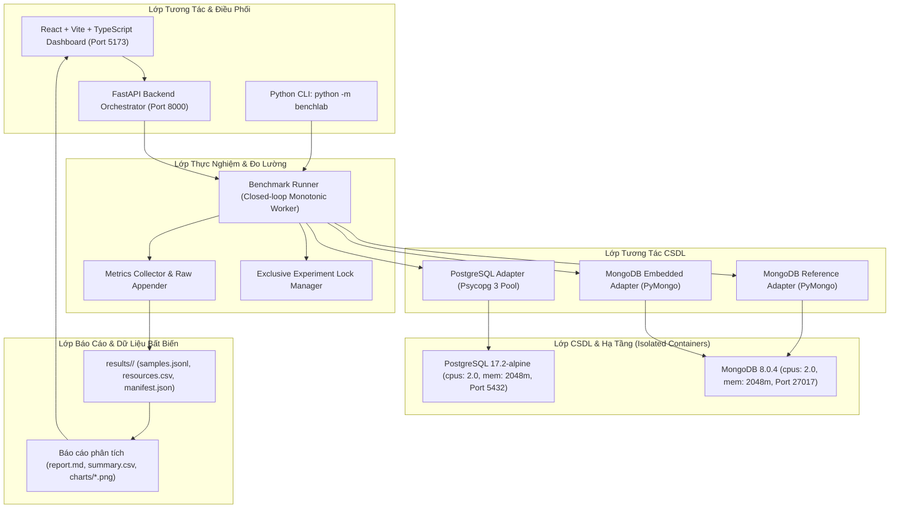

# KẾ HOẠCH TRIỂN KHAI HỆ THỐNG (IMPLEMENTATION PLAN)

## Đề tài: Đánh giá hiệu năng truy vấn giữa CSDL quan hệ (PostgreSQL) và CSDL NoSQL (MongoDB)

**Phiên bản:** 1.0  
**Ngày phê duyệt:** 30/09/2026  
**Đặc tả gốc:** `docs/SPEC.md` (v1.0)  

---

## 1. Mục tiêu và các câu hỏi nghiên cứu
Dự án xây dựng một nền tảng thực nghiệm nghiêm ngặt nhằm so sánh định lượng hiệu năng truy vấn giữa PostgreSQL 17 và MongoDB 8 trên cùng một bài toán nghiệp vụ thương mại điện tử với tập dữ liệu chuẩn hóa duy nhất.

Hệ thống phải trả lời chính xác 6 câu hỏi nghiên cứu:
1. **Độ trễ và thông lượng:** Với tài nguyên kiểm soát, mỗi hệ thể hiện độ trễ (p50, p95, p99) và thông lượng (success QPS) ra sao đối với từng nhóm truy vấn (point query, range filter, aggregation, join/lookup, deep pagination)?
2. **Quy mô và tải đồng thời:** Khi tăng quy mô dữ liệu (small -> medium -> large) và số kết nối đồng thời ($C \in \{1, 8, 32\}$), độ trễ biến thiên thế nào và tỷ lệ lỗi/timeout xuất hiện ở đâu?
3. **Hiệu quả của Index:** Bổ sung index (chế độ I1) làm thay đổi độ trễ truy vấn, kích thước lưu trữ và thời gian xây dựng index như thế nào?
4. **Chi phí kết nối dữ liệu (Track A):** Phép `JOIN` quan hệ trong PostgreSQL và `$lookup` trong MongoDB tham chiếu khác nhau ra sao về mặt hiệu năng trên cùng mô hình dữ liệu?
5. **Mô hình nhúng (Track B):** Khi MongoDB nhúng chi tiết đơn hàng (`orders_embedded`), truy vấn đọc (Q8) được cải thiện bao nhiêu và sự đánh đổi về lưu trữ/cập nhật là gì?
6. **Giải thích bằng Execution Plan:** Các chỉ số của PostgreSQL `EXPLAIN (ANALYZE, BUFFERS)` và MongoDB `explain("executionStats")` có giải thích đầy đủ các quan sát thực nghiệm hay không?

---

## 2. Kiến trúc tổng thể và phân lớp hệ thống



---

## 3. Đánh giá phần cứng thực tế và khả năng thực thi

### 3.1. Thông số máy thí nghiệm thực tế
- **Hệ điều hành:** Windows 10 Pro Education (Build 19045), x86_64.
- **Bộ vi xử lý (CPU):** Intel(R) Core(TM) i5-6300U CPU @ 2.40GHz (2 nhân vật lý, 4 luồng xử lý).
- **Bộ nhớ RAM:** 15.86 GiB tổng (~9.2 GiB khả dụng).
- **Lưu trữ:** Phân vùng D: trống 62.64 GB; Phân vùng C: trống 44.79 GB.
- **Runtimes:** Python 3.12.6, Node.js v22.16.0, Git 2.51.1.

### 3.2. Quyết định phân bổ tài nguyên (DEC-002)
- Hạn ngạch container cho mỗi CSDL: **2 vCPU** và **2048 MB RAM**.
- Giữ lại 2 luồng logic và ~6 GiB RAM cho Windows OS, tiến trình runner và API để tránh hiện tượng nghẽn do tranh chấp tài nguyên với host.
- Thực thi tuần tự (Mutual Exclusivity): Chỉ một CSDL hoạt động tại một thời điểm đo lường.

### 3.3. Ma trận khả thi của các Profile dữ liệu

| Profile | Số Khách | Số SP | Số Đơn hàng | Ước tính Items | Dung lượng đĩa | Mức độ khả thi trên máy trạm | Mục đích sử dụng |
|---|---:|---:|---:|---:|---:|:---:|---|
| `fixture` | 12 | 20 | 50 | ~150 | < 1 MB | **100% Khả thi** (< 1 giây) | Kiểm thử tính đúng với Oracle độc lập |
| `small` | 1.000 | 500 | 10.000 | ~30.000 | ~15 MB | **100% Khả thi** (~5 giây) | Smoke test E0, kiểm thử tích hợp, demo live |
| `medium` | 10.000 | 5.000 | 100.000 | ~300.000 | ~150 MB | **100% Khả thi** (~45 giây) | Ma trận thí nghiệm chính E1, E2, E3 |
| `large` | 100.000 | 20.000 | 1.000.000 | ~3.000.000 | ~1.5 GB | **Khả thi có điều kiện** (Chạy thử nghiệm pilot) | Đánh giá xu hướng tăng dữ liệu; công bố rõ nếu chưa đủ thời gian chạy đủ 5 repeat |

---

## 4. Lộ trình triển khai theo 11 Phase và Tiêu chí nghiệm thu (Gates)

```
Phase 0 [G0] ──> Phase 1 [G1] ──> Phase 2 [G2] ──> Phase 3 [G3] ──> Phase 4 [G4] ──> Phase 5 [G5]
                                                                                        │
Phase 10 [G10] <── Phase 9 [G9] <── Phase 8 [G8] <── Phase 7 [G7] <── Phase 6 [G6] <────┘
```

### Phase 0: Khởi tạo phạm vi và kiểm tra môi trường
- **Công việc:** Thu thập cấu hình máy thật, chốt phiên bản CSDL và runtime, tạo `.gitignore`, `.env.example`, lockfiles, lập kế hoạch, skeleton repo, xây dựng `scripts/doctor.py` và `python -m benchlab doctor`.
- **Gate G0:** Kiểm tra pre-flight PASS 0 lỗi chặn, mọi giả định và hạn ngạch tài nguyên được lưu tại `docs/decisions.md`.

### Phase 1: Hạ tầng và kết nối
- **Công việc:** Thiết lập `docker-compose.yml` với PostgreSQL 17.2 và MongoDB 8.0.4, quota 2 vCPU / 2048m, healthcheck. Xây dựng interface adapter kết nối (`health`, `prepare`, `execute`, `explain`), API `/api/health`.
- **Gate G1:** Kết nối hai DB thành công, xử lý lỗi down DB và timeout chính xác, xác minh quota runtime.

### Phase 2: Schema, generator và nạp dữ liệu
- **Công việc:** Định nghĩa DDL PostgreSQL, MongoDB validator cho Track A và Track B. Xây dựng data generator streaming (seed=42, tiền nguyên, UTC millisecond, ID int64). Xây dựng bulk batch loader, validator đối chiếu checksum và toàn vẹn dữ liệu. Cấu hình I0/I1 catalog.
- **Gate G2:** Fixture và small đạt 100% tương đương dữ liệu; generator xử lý streaming không quá tải RAM.

### Phase 3: Query catalog và kiểm tra kết quả
- **Công việc:** Triển khai truy vấn chuẩn Q1–Q8 và các biến thể Q7 trên cả hai adapter. Xây dựng parameter pool (>= 200 bộ) và Python Oracle độc lập. Tạo API `/api/queries/execute` và `/api/queries/explain`.
- **Gate G3:** Toàn bộ query và biến thể trên fixture khớp 100% với Oracle; consume hết cursor; format output chuẩn hóa.

### Phase 4: Benchmark runner và lưu trữ dữ liệu thô
- **Công việc:** Xây dựng runner hỗ trợ Mode L (Latency tuần tự) và Mode T (Throughput closed-loop). Monotonic clock `time.perf_counter_ns()`, warm-up protocol (>= 20s, >= 100 requests), luân phiên engine, lưu `samples.jsonl`, `resources.csv`, `manifest.json`. Exclusive lock toàn cục và cơ chế cancel/recovery.
- **Gate G4:** Chạy thành công E0 smoke; timer chỉ bao gồm thực thi + nạp cursor; ghi nhận đầy đủ timeout/lỗi.

### Phase 5: Dashboard và điều phối job
- **Công việc:** Xây dựng giao diện React + Vite: Trang Tổng quan, Dữ liệu, Truy vấn, Benchmark, Kết quả, Kiểm thử. Polling tiến độ thật; hiển thị plan chẩn đoán; chống double-submit.
- **Gate G5:** Không có nút giả; mọi số liệu lấy từ API thật; ghi hình walkthrough luồng chính.

### Phase 6: Phân tích, biểu đồ và báo cáo
- **Công việc:** Tính toán thống kê per-run, bootstrap 95% CI theo cặp repeat. Vẽ biểu đồ latency p50/p95/p99, throughput, CPU/RAM. Xuất bundle Markdown, CSV và chart PNG.
- **Gate G6:** Công thức thống kê được kiểm chứng độc lập; không trộn lẫn dữ liệu minh họa vào báo cáo chính thức.

### Phase 7: Kiểm thử toàn diện hệ thống và ổn định hóa
- **Công việc:** Thực thi toàn bộ 33 ca kiểm thử trong ma trận; kiểm tra bảo mật (chống SQL injection, chống path traversal). Sửa toàn bộ lỗi Critical và High.
- **Gate G7:** Tất cả test bắt buộc PASS; không còn lỗi Critical/High tồn đọng.

### Phase 8: Thực nghiệm benchmark chính thức
- **Công việc:** Khóa commit, cấu hình và dataset. Chạy ma trận E1 (small, medium), E2 (medium C=1, 8, 32), E3 (Track B), và pilot E1-large.
- **Gate G8:** Hoàn thành ma trận hoặc công bố rõ phần giới hạn chưa chạy.

### Phase 9: Đánh giá, báo cáo và diễn tập demo
- **Công việc:** Soạn thảo báo cáo nghiên cứu 10 chương; giải thích nguyên nhân bằng `EXPLAIN`; chuẩn bị kịch bản demo 10–12 phút và bộ câu hỏi phản biện.
- **Gate G9:** Demo trơn tru, số liệu minh bạch, kết luận có điều kiện.

### Phase 10: Đóng gói và bàn giao
- **Công việc:** Hoàn thiện README tái lập từ đầu (clean-start); kiểm tra không lộ bí mật; bàn giao bundle mã nguồn, tài liệu và dữ liệu thô.
- **Gate G10:** Người dùng chạy được từ kho mã nguồn sạch theo đúng README.

---

## 5. Ma trận Yêu cầu ↔ Kiểm thử (Requirements to Test Matrix)

| Mã Test | Nhóm | Nội dung kiểm thử | Tiêu chí đạt (Expected Outcome) | Phase kiểm chứng |
|---|---|---|---|:---:|
| **ENV-01** | Môi trường | Khởi động hạ tầng từ môi trường sạch | Health PASS, đúng version (PG 17.2, Mongo 8.0) và quota (2 vCPU, 2048m) | Phase 1 |
| **ENV-02** | Môi trường | Dừng một CSDL khi đang chạy | Báo degraded/503 có thông báo, không treo vô hạn | Phase 1 |
| **DATA-01** | Dữ liệu | Sinh 2 lần cùng seed=42 và profile | SHA-256 canonical checksum giống nhau 100% | Phase 2 |
| **DATA-02** | Dữ liệu | Sinh với seed khác | Dữ liệu và hash khác, nhưng vẫn đạt toàn vẹn cấu trúc | Phase 2 |
| **DATA-03** | Dữ liệu | Đối chiếu số lượng entity giữa PG và Mongo | Số lượng customers, products, orders, items trùng khớp tuyệt đối | Phase 2 |
| **DATA-04** | Dữ liệu | Cố ý làm sai tổng tiền hoặc thiếu item | Công cụ validator phát hiện chính xác bản ghi lỗi | Phase 2 |
| **DATA-05** | Dữ liệu | Dữ liệu có ID trùng hoặc giá trị âm | Loader từ chối nạp, trả mã lỗi chi tiết | Phase 2 |
| **DATA-06** | Dữ liệu | Nạp lại (re-load) cùng một dataset | Thao tác idempotent, không làm nhân đôi bản ghi | Phase 2 |
| **QUERY-01** | Tính đúng | Thực thi Q1–Q8 trên fixture | Kết quả khớp 100% với Python Oracle và khớp giữa hai DB | Phase 3 |
| **QUERY-02** | Tính đúng | Truy vấn với ID không tồn tại hoặc filter rỗng | Trả về 0 dòng hoặc rỗng theo đúng contract, không lỗi crash | Phase 3 |
| **QUERY-03** | Tính đúng | Bộ lọc khoảng ngày `[from, to)` | Bao gồm thời điểm `from`, loại trừ thời điểm `to`, chuẩn UTC | Phase 3 |
| **QUERY-04** | Tính đúng | Trùng ngày hoặc doanh thu | Sắp xếp phá hòa ổn định bằng khóa phụ (order_id) | Phase 3 |
| **QUERY-05** | Tính đúng | Q5 và Q6 khi đơn có nhiều dòng sản phẩm | Không nhân đôi doanh thu khi join chi tiết đơn hàng | Phase 3 |
| **QUERY-06** | Tính đúng | Phân trang sâu Q7 giữa offset và keyset | Cùng 50 kết quả và cùng thứ tự tại cùng anchor | Phase 3 |
| **QUERY-07** | Tính đúng | Q8 đối chiếu Track A (JOIN/lookup) và Track B (Embedded) | Cấu trúc JSON chuẩn hóa hoàn toàn tương đương | Phase 3 |
| **INDEX-01** | Index | Chuyển đổi giữa chế độ I0 và I1 | Áp dụng đúng catalog; bảo tồn các ràng buộc duy nhất cốt lõi | Phase 2 |
| **INDEX-02** | Index | Thu thập Explain plan trên dataset medium | Plan được lưu lại dưới dạng JSON thô; nhận diện đúng scan type | Phase 3 |
| **BENCH-01** | Đo lường | Adapter giả lập độ trễ execute và fetch | Timer ghi nhận đầy đủ cả thời gian execute lẫn consume cursor | Phase 4 |
| **BENCH-02** | Đo lường | Thao tác mở kết nối, tính hash, serialize JSON | Không bị cộng dồn vào độ trễ truy vấn (`timed region`) | Phase 4 |
| **BENCH-03** | Đo lường | Kiểm tra số request giai đoạn warm-up | Các mẫu warm-up bị loại bỏ hoàn toàn khỏi tập mẫu đo chính | Phase 4 |
| **BENCH-04** | Đo lường | Chế độ Mode L với N request, C=1 | Ghi nhận chính xác N mẫu; mỗi mẫu có trạng thái rõ ràng | Phase 4 |
| **BENCH-05** | Đo lường | Chế độ Mode T với C=8 | Concurrency thực tế đạt 8 worker, không vượt quá giới hạn | Phase 4 |
| **BENCH-06** | Đo lường | Dừng phát khi hết hạn 60s, chờ drain | QPS tính theo đúng wall_elapsed_s; không bỏ sót request đang chạy | Phase 4 |
| **BENCH-07** | Đo lường | Query bị quá thời gian (timeout) | Ghi nhận timeout, tăng error rate, không tính là success | Phase 4 |
| **BENCH-08** | Đo lường | Hủy thí nghiệm khi đang chạy (Cancel) | Dừng phát request mới, giải phóng lock, giữ nguyên dữ liệu partial | Phase 4 |
| **BENCH-09** | Đo lường | Đột ngột tắt worker rồi bật lại API | Job chuyển trạng thái `INTERRUPTED`, không tự thành `COMPLETED` | Phase 4 |
| **BENCH-10** | Đo lường | Kiểm tra thứ tự và hạt giống trace | Đúng quy tắc luân phiên PG <-> Mongo, dùng chung trace tham số | Phase 4 |
| **BENCH-11** | Đo lường | Cố gắng nạp dữ liệu khi đang benchmark | Trả về mã lỗi 409 Conflict; khóa thực nghiệm được bảo vệ | Phase 4 |
| **STAT-01** | Thống kê | Dữ liệu mẫu `[1, 2, 3, 4, 5]` ms | Mean = 3.0, p50 = 3.0, p95 = 4.8 (với linear interpolation) | Phase 6 |
| **STAT-02** | Thống kê | 100 thành công, 10 lỗi trong 10 giây | success_qps = 10.0, attempt_qps = 11.0, error_rate = 10/110 | Phase 6 |
| **STAT-03** | Thống kê | Tập dữ liệu 0 mẫu hoặc phép chia cho 0 | Trả về N/A kèm lý do, không chuyển đổi NaN thành 0 ms | Phase 6 |
| **STAT-04** | Thống kê | Tái tính toán số liệu tóm tắt từ raw samples | Khớp 100% với summary.csv | Phase 6 |
| **STAT-05** | Thống kê | Bootstrap khoảng tin cậy 95% cùng seed | Cho kết quả tái lập tuyệt đối, lấy mẫu ở cấp cặp repeat | Phase 6 |
| **API-01** | An toàn | Tham số âm, query ID lạ, ngày ngược | Trả về mã 422 Unprocessable Entity kèm thông báo chi tiết | Phase 7 |
| **API-02** | An toàn | Gửi chuỗi injection SQL hoặc NoSQL | Bị validation chặn hoặc bind an toàn dưới dạng giá trị tham số | Phase 7 |
| **API-03** | An toàn | Tải file xuất với đường dẫn chứa `../` | Chặn đứng hành vi Path Traversal, chỉ đọc trong thư mục cho phép | Phase 7 |
| **UI-01** | Giao diện | Luồng E2E từ nạp dữ liệu đến xem kết quả | Dữ liệu thật được cập nhật xuyên suốt các màn hình | Phase 5 |
| **UI-02** | Giao diện | Nhấn đúp nút bắt đầu hoặc tải lại trang | Không tạo job trùng lặp, duy trì tiến độ đúng | Phase 5 |
| **UI-03** | Giao diện | Trạng thái rỗng, CSDL offline, job bị hủy | Hiển thị rõ thông báo trạng thái, không để giao diện treo | Phase 5 |
| **REPORT-01**| Báo cáo | Xuất báo cáo thí nghiệm hoàn chỉnh | Đầy đủ manifest, raw samples, summary, plans và biểu đồ | Phase 6 |
| **REPORT-02**| Báo cáo | Xuất dữ liệu minh họa hoặc chạy dở | Luôn gắn nhãn DỮ LIỆU MINH HỌA hoặc BÁO CÁO MỘT PHẦN | Phase 6 |
| **RELEASE-01**| Bàn giao | Khởi động lại theo hướng dẫn README | Chạy thành công smoke test từ mã nguồn sạch | Phase 10 |

---

## 6. Các quy tắc bất biến (Critical Invariants)
1. **Không tạo số đo giả:** Mọi số liệu hiển thị trên kết quả và báo cáo phải được tính trực tiếp từ tệp `samples.jsonl` thu thập trong quá trình chạy.
2. **Không hardcode kết quả:** Tuyệt đối không cài cắm bên thắng hoặc số mili-giây cố định.
3. **Phân tách rạch ròi đo thử và benchmark:** Thao tác "Chạy thử một lần" tại màn hình Truy vấn được gắn nhãn "Đo thử — không đại diện benchmark" và không được lưu vào kho kết quả chính thức.
4. **Bảo vệ ranh giới đồng hồ đo:** Đồng hồ `time.perf_counter_ns()` chỉ bao bọc lời gọi CSDL và việc decode nạp hết cursor; loại bỏ hoàn toàn các thao tác serialize HTTP, lưu file, hash dữ liệu.
5. **Cô lập tài nguyên:** Chỉ một CSDL chạy tải tại một thời điểm; CSDL còn lại ở trạng thái nghỉ.
